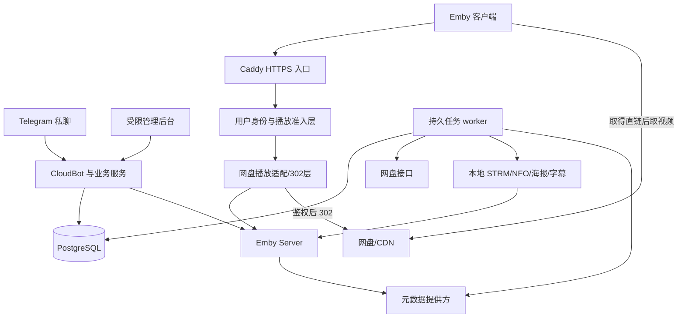

# 01 总体架构与媒体自动化

当前媒体执行契约见[第13篇](13-Emby与自动追更最终实施规格.md)：由Emby负责元数据补缺；稳定取源入口必须真实可读，缺少现成映射时将内网OpenList作为所选方案依赖计入预算。

v6增加[防扫库/连点网关契约](21-防扫库重复点击与攻击防护.md)：所有公网媒体路线覆盖鉴权、对象权限、分组预算与签发合并。只限制Bot/业务API不能宣称Emby防护完成；正常Range/HLS/心跳独立分类。控制器仍复用唯一服务，不为防护再叠多套用户中心或公网代理。

## 1. 定位与当前约束

这是一个由个人维护、可邀请他人使用的云盘 Emby 服务。首期目标是小规模稳定可用，同时把注册、保号、积分和购买规则设计完整。用户希望先得到完整方案，本阶段不把方案描述成已经可运行的成品。

现有美西 VPS 为 2核2GB。视频放网盘，本地保留媒体索引、海报、字幕、配置和业务数据；原文中的 30GB 磁盘容量仅作预算假设。目标规模先以 1～5 名实际使用者、1～2 路同时播放验证，不承诺相应并发上限。注册容量与同时播放容量分开管理。

第一阶段适合：普通视频直播放、有限目录的同步、单任务刮削、一个 Bot、少量用户权益维护。不适合在同机承担大规模转码、全库高频探测、大下载、自动下载全家桶和多个重复用户中心。

主要成功条件是四条独立链路都可验证：

| 链路 | 验证问题 |
|---|---|
| 用户→美西 VPS | 登录、海报、媒体库加载是否稳定？ |
| VPS→网盘 API | 列目录、授权、获取地址是否可靠？ |
| 用户→网盘 CDN | 实际客户端能否拉取、拖动、连续播放？ |
| VPS→Telegram/TMDB | 菜单、通知、元数据查询是否可靠？ |

美西服务器能访问网盘，并不能证明大陆客户端能播放。普通直播放也不能证明视频没有经过 VPS，必须验证 302 和网卡流量。

## 2. 功能边界与组件

| 层 | 首期选择 | 职责与边界 |
|---|---|---|
| 媒体中心 | Emby Server | 媒体库、用户登录、观看历史、收藏、播放器协议 |
| 网盘适配 | 一个验证通过的适配器；优先测试 OpenStrm | 目录差异、STRM、播放映射；不负责本项目积分与付费规则 |
| 用户业务 | Cloud Controller逻辑模块，优先在验证通过的Twilight扩展 | 唯一身份、权益、积分与任务写入者 |
| TG 入口 | CloudBot，与控制器同仓同业务模块 | 菜单、通知、管理命令；不单独维护另一份余额 |
| 数据库 | 单实例 PostgreSQL | 业务事实、事务、持久任务和通知发件箱 |
| 入口 | Caddy | TLS、反代、访问日志脱敏；不是自动获得 302 能力的组件 |
| 任务执行 | 控制器内后台 worker | 持久任务表、重试、单实例调度锁 |
| 按映射决定的依赖 | OpenList或已验证的现有可读来源 | 没有现成有效入口时优先验证内网OpenList；不遗漏资源预算 |
| 可选 | rclone、外部存活探测 | 异地备份与外部可用性监控 |

推荐业务代码采用 Go 模块化单体，减少进程和依赖数量；后台与 Bot 调用相同服务层。并非必须使用 Go，若采用其他语言仍必须满足本文事务和鉴权约束。PostgreSQL 初期一台一库即可，不把 Redis 作为正确性的必要条件。

v3复用优先：先验证Twilight固定版本，通过后作为唯一用户中心补充差异；不允许两套系统分别改到期或余额。若事务、权限、扩展或资源不符合，再切自建轻量Go单体。选型验证、AGPL许可与差距见[第08篇](08-成熟方案对照与复用路线.md)。[项目依据](https://github.com/Prejudice-Studio/Twilight)

## 3. 逻辑架构



首期先让现成播放适配器通过普通鉴权与播放测试。自定义“播放准入层”是后续开发模块，不是 Caddy 配几条规则就自动具备；在它完成前，设备上限只提供提示或审核，同播使用经验证的 Emby 原生能力或检测告警，不宣传硬限制。

公众只访问统一 Emby 域名；Emby 原端口、302 原端口、网盘管理端口都留内网。控制器通过内部 Emby 地址执行管理 API；普通用户凭据不得升级为管理员 API Key。

## 4. 两类播放路径

### 4.1 首选：直链重定向

1. 客户端登录 Emby，获取用户令牌。
2. 所有公开媒体 API 先经过统一入口；播放相关请求保留用户令牌、条目、设备与播放上下文。
3. Emby 按用户身份确认该条目可见；业务层确认权益、设备、同播准入。
4. 适配器把条目映射到网盘稳定文件标识，临时获取可播放地址。
5. 返回 302；客户端直接向网盘/CDN 请求视频。
6. 客户端继续向 Emby 上报播放进度，控制器做观影与会话统计。

OpenStrm 文档说明了 115 302、客户端访问其代理端口以及鉴权相关设置。本方案只把它作为候选基础，并要求固定版本进行准入与绕过测试。匿名重定向保持关闭；不能用服务器管理员密钥替无身份客户端解析直链。[项目说明](https://github.com/indown/OpenStrm)

STRM 是文本媒体入口，可以写 URL 或媒体路径；它不是视频，也不自带版权、鉴权、302 或直播放保证。[Emby STRM 文档](https://emby.media/support/articles/Strm-Files.html)

STRM 内优先保留稳定映射，例如内网文件入口或适配器支持的稳定路径。不要把几分钟后失效的网盘临时签名地址长期写入 STRM；也不要为所有用户共享一个长期免鉴权公网链接。若内网 `/d/` 入口必须关闭签名，网络层只允许 Emby/适配器访问，不能发布到公网。

### 4.2 兼容：受控回源

无法 302 的网盘、客户端或格式，需要决定允许回源、仅特定套餐允许、或直接提示不支持。回源时 VPS 承担视频流量，音频转码、封装转换和字幕烧录也可能让视频经过 VPS。

2GB 首期默认禁止视频转码，禁用自动回源到大量未知来源；音频转码也先关闭或严格限制到单任务，确认字幕格式和客户端解码能力。需要转码的资源应在入库前生成兼容版本，或等待有硬件加速的新节点。

不能把“Direct Play”“Direct Stream”“不转码”“302”混为一谈；每次验收记录实际来源、是否重定向、VPS 流量和转码进程。源必须支持正常 Range/206、拖动和断线恢复；短时 HTTP 检查与完整播放测试分别记录。

## 5. 302 的真实限制与取舍

- 直链签发后，客户端可在其有效期内继续读取；禁用账号、解绑设备、Bot 踢会话不能保证当前 CDN 请求立即停止。
- Device ID 和客户端名称通常由客户端申报，可复制；设备列表是软件身份管理，不是硬件认证。
- Emby 播放事件可丢失或伪造；只有观察数据，不能证明真人观看。
- VPS 看不到直链所有视频字节；不应按 VPS 网卡反推个人观影流量，也不能把会话统计宣传成 CDN 实际在线人数。
- 网盘若绑定 IP/UA/Cookie，必须分别验证 VPS 获取地址与客户端读取是否相容；不把 Cookie 下发给用户，也不通过轮换账号绕过限流。

本项目取舍：首期优先直链与低资源占用，接受可解释的软件限制。需要绝对连接数或带宽控制时改走受控代理，另算线路与费用；没有低成本兼得的承诺。

## 6. 网盘接入规范

初期只接一个现有网盘；若尚未持有，先用少量样片验证候选，再决定购买。海外网盘和对象存储仅作为扩展候选，不在此阶段做价格推荐。

每个账号保存能力档案：驱动/版本、授权类型、稳定文件 ID、目录枚举能力、增量游标、Range、直链时效、客户端必需头、跨 IP 可用性、字幕访问、并发/限流、风控状态、最近通过测试日期。

| 接入等级 | 允许用途 |
|---|---|
| A：客户端可直接取流，拖动稳定 | 默认主力播放源 |
| B：可取流但有 UA/IP/客户端限制 | 只开放已通过的客户端组合 |
| C：只能服务端代理 | 默认隐藏或按单独限额开放 |
| D：只能目录/备份访问 | 不进入可播放媒体库 |

OpenList 的存储驱动能力不能自动等同于 Emby 播放能力；rclone 的同步能力也不能替代授权与直链测试。[OpenList 驱动文档](https://doc.oplist.org/guide/drivers) / [rclone 文档](https://rclone.org/docs/)

同一个网盘账号全局串行或极低并发：目录、整理、转存、直链请求共用限流预算，播放签发高于后台扫描。遇到 429 服从 Retry-After；遇授权失效/风控暂停整个账号后台队列并告警，不逐文件不断重试。起始速率是本地保守设置，不是网盘官方许可配额。

## 7. 媒体目录与元数据归属

```text
/srv/cloud-emby/
  emby/config/                  # Emby 数据库、用户和配置
  adapter/config/               # 网盘适配器数据库与凭据
  controller/                   # 业务配置与运行目录
  media/staging/                # 半成品，不被 Emby 扫描
  media/published/Movies/
    示例电影 (2026) [tmdbid=123]/
      示例电影 (2026) - 1080p.strm
      movie.nfo
      poster.jpg
      示例电影 (2026) - 1080p.zh-CN.srt
  media/published/TV/
    示例剧集 (2026) [tmdbid=456]/Season 01/
      示例剧集 - S01E01.strm
      示例剧集 - S01E01.nfo
  postgres/
  backup-staging/               # 有大小上限，不等同异地备份
```

电影用名称＋年份，剧集用 SxxEyy。动漫记录绝对集数与季集映射；特别篇进 Season 00，合集、多集文件和分段电影单独标记，不能强行当普通一集。[电影命名](https://emby.media/support/articles/Movie-Naming.html) / [剧集命名](https://emby.media/support/articles/TV-Naming.html)

一个逻辑作品可包含多季集、多版本、多物理来源，去重按作品ID＋季集＋版本；同名不等于重复。v4首期由Emby负责元数据与图片补缺、保存到其配置/缓存，媒体工具只同步可信已有随片文件和规范命名。Emby媒体目录只读，关闭向该目录保存NFO/图片；未来改导入工具管理元数据时迁移所有权，禁止双写。人工锁定优先。

Emby 只读挂载 published；整理进程可写 staging/published。关闭昂贵的章节缩略图、视频预览与全量媒体深度分析，按需手动开启。图片限尺寸和数量，不能因影片在网盘就忽略本地海报占用。

## 8. 自动入库流水线

```text
发现变化 → 来源/季集校验 → 获取/转存完成 → 文件稳定检查
→ 生成STRM并同步已有随片文件 → 原子发布
→ Emby定向扫描与元数据补缺 → 确认条目可见
→ 轻量播放探测 → AVAILABLE（海报可暂缺）→ 合并通知
```

三个入口：自己上传/转存后的目录变化、已授权分享追更、管理员/求片任务选定的资源。TMDB 提供元数据，不提供视频文件；Sonarr/Radarr 如未来采用，也需要合法资源源与下载/导入链路，首期不部署。扫描已有网盘目录只会更新已有文件，不会凭空获得新集。

每步写持久状态与错误：`DISCOVERED / MATCH_PENDING / ACQUIRING / FILE_READY / PUBLISHED / INDEXED / AVAILABLE`；元数据补全单独状态。临时失败RETRY_WAIT，授权BLOCKED_AUTH，歧义MANUAL_REVIEW。INDEXED只代表入库，AVAILABLE代表当前测试链路可播放；其他客户端仍需验收，具体闭环见第13篇。

具体约束：

1. 上传完成以提供方完成标识为准；没有标识时两次目录采样大小稳定且可读作为弱信号，并标注未做全文件校验。hash 只有来源提供或实际计算过才能保存，不能从文件名伪造。
2. 识别先读 NFO/人工绑定 ID，再匹配名称年份、季集；模糊匹配进待确认。先预览后批量重命名，不执行自动删除冲突文件。
3. 索引及已有随片文件在staging完成后同文件系统原子rename，按版本清单发布；由Emby生成的元数据随后补缺，不把它误作发布前必需。失败保留旧索引。
4. 单个文件失败不阻塞全库；账号授权失效则暂停该账号所有任务。任务有幂等键 `(storage_account, remote_file_id, source_version, operation)`。
5. 扫描请求按目录合并，等待 60～120 秒再触发；优先目标目录/条目刷新。API 不支持局部操作时才批量全库扫描，不能每个文件扫一次全库。
6. API 接收刷新请求不等于完成，需轮询对应条目与任务状态。只有索引可见并通过探测后发“可观看”；否则显示“已同步，等待索引/待修复”。
7. 字幕先同步来源已有字幕；UTF-8 与语言后缀规范化、按季集/版本匹配。外部字幕下载仅在合法来源和授权配置完成后启用；不默认做 AI 转写。
8. 自动更新已有媒体时保留稳定标识与用户记录；路径大改需先验证 Emby 是否识别为原条目。替换后观影历史迁移不能凭方案保证，需样本演练。

## 9. 追更、缺集与资源替换

订阅记录作品 ID、期望季、已知总集数、更新源、语言/字幕要求、最高码率、当前版本、截止日期、申请者。允许只订阅后续通知，不自动取得文件。

新集到达只处理差异；重复事件通过幂等键跳过。季度结束后降频；连续失败到阈值进入人工处理。片源升级先建立新版本、验证播放，再切换默认来源；旧版进入至少 7 天隔离期，管理员确认后才清理。原网盘文件不由“清理本地索引”自动删除。

缺集分为“未播出、已播未找到、已找到未入库、入库失败、上游缺失”，不可把未知总集数当成缺失。用户能看到状态、最后更新时间和最近失败原因的友好摘要。

## 10. 调度与异常删除保护

| 任务 | 初期频率/并发 | 失败处理 |
|---|---|---|
| 增量发现 | 优先事件；无事件时 15～30 分钟，抖动 | 用游标续跑，不能假设断线期间事件保留 |
| 文件稳定采样 | 2～5 分钟，最多 1 个后台重任务 | 不稳定则延迟 |
| 刮削整理 | 单 worker，批量小任务 | TMDB 故障保留旧元数据 |
| Emby 扫描 | 发布后合并触发 | 超时转待查，不重新生成一切 |
| 目录完整对账 | 每日低峰，一次一小批 | 中断不推进完整扫描水位 |
| 缺集检查 | 每日 | 来源不可达则标未知 |
| 授权探测 | 30～60 分钟，复用近期成功信号 | 失效暂停，不无限重登 |
| 播放抽样 | 每日少量固定样片＋上次失败项目 | 用小 Range，避免全文件下载 |

扫描为空、授权失败、提供方超时都不能作为删除依据。文件缺失先标 `SUSPECT_MISSING`，至少两轮完整成功扫描确认、相隔至少 24 小时，再隐藏；默认保留本地索引 7 天。若缺失比例超过 10% 或某根目录突然消失，触发全局删除熔断并人工确认，不能传播成全库清空。

## 11. 可见性与服务降级

普通用户只看到有权访问的库与版本；来源 Cookie、网盘账号、内部路径不公开。某网盘故障时展示“来源维护中”，同作品有已验证替代源时可供选择，不在正在播放中无条件无缝换源。

控制器故障与网盘故障分开处理：已经授权的播放尽量继续；新播放按缓存策略有限放行或拒绝；注册、兑换、扣积分和支付履约必须暂停到数据库可用。具体故障策略见运维文档。
