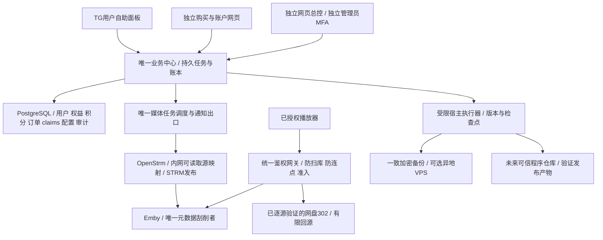

# 27 最终方案与遗漏闭环验收（v8）

最终整理日期：2026-11-19。交付是**完整设计＋配置示例＋静态交互原型＋设计核验**；程序仓库尚未建立，未部署VPS/支付/Bot/更新服务。此前v6.1明确的TG面板与独立网页总控分离继续保留。

v8保号以[第29篇](29-30天自动保号与20天切换冷却最终规则.md)为准：30天自动续期和20天实际换方式冷却分开，旧活动分/2日达标规则废止。

## 1. 最终架构与完整阅读入口

现有方案仓库存设计；未来程序仓库提供软件Release，更新助手在总控里管理但由独立受限执行器执行。两类仓库不混用。完整正文见[29篇合订本](完整方案.md)，模块字段清单见[第25篇](25-网页总控全部功能与字段清单.md)，完整更新流程见[第26篇](26-更新助手仓库拉取升级与回滚.md)。

## 2. 已确定的默认规则

| 项目 | 最终设计默认值/决定 | 完整规格 |
|---|---|---|
| VPS/媒体 | 现有美西2C2G，单重任务、禁止视频转码、不自动代理大流量；先单源/小规模实测 | 01/05/10/13 |
| 自动整理刮削追更 | OpenStrm候选，取源真实可读，Emby唯一刮削；四水位到可播才通知，复杂检索以后替换唯一调度者 | 01/08/13 |
| 注册 | 支持开放/邀请/购买组合，初始邀请；成员20/日新增3/全服同播2只是内测初值，已售未兑占容量 | 03/10/16 |
| TG面板 | 用户自助＋可选受限快捷，不承担全局网页总控，不可拿普通TG身份提权 | 02/09/15/22 |
| 网页总控 | 独立管理员账户/MFA/ADMIN_WEB，24模块、全部项目设置和工作流、权限/版本/回执 | 22/25 |
| 免费保号 | 30天窗A可用300授权扣分/B有效30分钟自动续原到期＋30；无签到天数硬门槛；真正换方式后20天冷却、解锁权保留 | 03/04/14 |
| 钱包签到 | 每天10～20整数等概率，均值15；本窗签到天数据真实日期展示，无活动分，同日重试同奖额 | 14 |
| 积分卡 | 300/850/3000分兑30/90/365天；从零月卡平均20.4889次签到，22次概率98.0433%，30次保证足够（不消费等假设） | 14 |
| 免活动 | 积分卡/购买/管理员grant有效期内免签到和观影，仍可自愿签到；同档顺延，安全封禁优先 | 03/16 |
| 安全与设备 | 独立安全码/一次性恢复码、敏感MFA、设备与同播分开；302不承诺绝对设备验证或已发直链立即撤回 | 04/09/21 |
| 独立网站购买 | 默认口令红包，可多选支付宝/微信静态码；Finance核真实到账后发UID绑定、单次、按核销起算的对应时长码 | 16/25 |
| 商品运营 | 月/年注册、续期、限期白名单；价格/效果/份额/限购/促销/上架可调，已售责任和退款继续履行 | 16 |
| TG发电外链 | 技术草稿保留，按2026-11-18已核验结论有效关闭；独立网址人工告知，付费码默认网页核销 | 24 |
| 内容与通知 | 帮助/公告/兼容禁用说明可编辑版本化，实际客户端拦截另验；统一通知/持久站内待办 | 17/25 |
| 扩展接口 | 游戏积分/异地推拉独立scope、预算/epoch/即时停用，默认关闭，不让外端任意设余额 | 18 |
| 域名/IP | 分用途域名、TLS/可信代理/IPv4/IPv6控制，裸IP默认关；管理入口受控且有救援 | 19 |
| 防护 | 鉴权/对象ACL/原端口隔离基础执行；行为先观察72小时、有限计数/合并/冷却，分片与控制请求分组 | 20/21/23 |
| 备份/迁移 | 基础即建一致加密备份；异地开关与本机计划分开，恢复演练与claim/支付/撤销水位验证，单主切换 | 11/18/25 |
| TG脚本与高峰注册 | 真实用户跨入口预算/2秒合并/失败冷却；2GB持久队列256、单开户worker、全状态有界与轮巡；手动/推荐/边界自动调预算，内存不自动扩大业务/安全限额 | 28 |
| 自动更新 | 程序仓库空、未配置不联网更新；未来检查→验证拉取→预检/备份→维护应用→健康验收；可选限定自动应用 | 26 |

所有人数/内存/频率/保留值为可调起始值或设计约束，不是已验证承载量。商品现金价、域名/网盘/磁盘实际值未提供，保持未就绪；不猜0元或默认收款账号开启销售。

## 3. 本轮发现并闭环的遗漏

| 编号 | 之前不足/容易遗漏的点 | v7处理及实施验收 |
|---|---|---|
| GAP-01 | 总控19模块只有代表字段，不足以逐项核对全部设置 | 扩24模块、全部16份配置字段归属索引；实施逐字段权限/类型/回执验收，不冒称完整后端已做 |
| GAP-02 | 备份计划与异地API容易被混成同一开关 | 新增本机恢复策略，异地仅传输；分别显示生成/加密/回执/恢复，关闭异地不丢本机备份 |
| GAP-03 | “收款设置”遗漏待核、异常、补发和退款工作台 | 收款渠道、通知、实收核准、码交付、换码、退款、对账均由网页总控覆盖，真实到账优先 |
| GAP-04 | 更新只有固定版本原则，无可执行步骤 | 独立更新助手、三种自动化策略/关闭、仓库空状态、可信Release/源码拉取、权限/维护/状态机 |
| GAP-05 | 把方案仓库当程序仓库，或git pull覆盖生产 | 明确仓库职责，未来程序仓库null；隔离fetch精确commit/验产物，不对运行目录直接pull |
| GAP-06 | Web自身更新时任务失联/重复执行 | 独立执行器、持久operation/checkpoint、fenced单执行者、断线重连查询、离线救援 |
| GAP-07 | 程序回退和旧数据库恢复混用 | schema兼容才退程序；配置生成新版本；有新写入先对账，禁止自动旧库覆盖 |
| GAP-08 | 2GB升级瞬时镜像/快照/编译爆内存或磁盘 | CI预构建、流式单下载/单重任务、峰值资源预检、短维护、保留上版，不全局prune |
| GAP-09 | 更新/恢复/迁移/域名切换/媒体重扫互抢 | 共用变更协调器与重任务预算，排队/排空/安全取消，无双写主节点 |
| GAP-10 | 通知依赖TG，Bot故障就丢核款待办 | 独立通知中心、持久站内待办、脱敏备用渠道、outbox幂等/死信；用户现金详情仍独立网站 |
| GAP-11 | 外部能力/secret无法编辑会被当遗漏 | 明确只读约束、专用工作流、secret只写引用和第三方能力状态；无任意终端/SQL |
| GAP-12 | 更新期间Webhook/轮询提前确认丢用户操作 | 仅持久接收后确认；无法持久则可重试响应，不提前推进offset，恢复按inbound/outbox去重 |
| GAP-13 | 未注册用户买注册码前无UID，取码需先占席位 | 网站建待注册UID、一次挑战绑定TG、一码一身份；资格与Emby成员分开，未兑预留入容量 |
| GAP-14 | 升级供应链只验同站SHA256、远程Compose可提权 | 可信身份/签名/摘要/时效/sequence、固定模板审查、阻断远程include/任意挂载/宿主脚本 |
| GAP-15 | 实施顺序遗漏总控/恢复/更新验收 | 新分期将独立总控从基础期建立、付款前演练恢复，自动应用最后放行，见下表 |
| GAP-16 | TG连点/脚本攻击只在泛用回调原则提及 | 独立TG入口/动作/失败/发送预算、跨入口同身份、缓存前权限、有限回应与状态键 |
| GAP-17 | 内存升级后何时调缓存/并发不清楚 | 档位表、手动/推荐手动/边界自动、逐项Owner上限和证据、压力滞回；不自动放宽安全频率/业务容量 |
| GAP-18 | 100+邀请码同时使用导致开户/DB/哈希洪峰 | 放号预检、数据库有界意向/状态、单worker/少量预取、公平轮巡、日配额/席位事务、未知结果对账 |
| GAP-19 | 把20天换方式间隔误作考核，签到2天即续期 | 改30天窗A授权够300扣分/B有效30分钟自动续原到期＋30，实际换方式后才冷却20天，免保号尾窗自愿，窗口/钱包/切换并发与恢复统一 |

本表是当前已知遗漏的闭环，不声称无法再出现缺陷。正式开发新增业务/字段时同步更新注册表、验证和验收用例。

## 4. 最终实施顺序与放行门槛

| 阶段 | 实施内容 | 必须验收才开放 |
|---|---|---|
| 0 选型与工程 | 验证成熟底座许可/API/资源；建未来程序仓库/CI与兼容清单，确定唯一账本/调度/Bot收件者 | 固定版本、真实来源和原型差距，未通过不硬复用 |
| 1 单源媒体/管理基础 | VPS/TLS/隔离、Emby+有效取源+STRM、最小独立网页Owner/MFA、凭据/配置/审计、本机备份 | 真实播放/拖动/字幕、管理员/TG隔离、加密备份可读；不公开注册/销售 |
| 2 自动媒体/防护 | 新集/补集/刮削/定向扫描/通知、网关全部公开路由、观察与误伤回归、资源任务预算 | 无重复发布/异常删库，正常客户端通过且无绕过原端口 |
| 3 TG账户/规则 | 注册邀请、30天自动续/20天实际切换冷却、免保号尾窗自愿、观影采集、随机签到/积分、设备/同播、帮助工单、总控对应全部设置 | 并发/幂等/故障豁免、地址和个人数据隔离；硬设备保证未验不销售相关权益 |
| 4 独立商店/恢复 | 渠道版本、份额/优惠、人工核款/单次码、通知/退款/对账、异地接口、隔离恢复 | 核款/claim/退款竞争、迟到付款、旧备份码复活防护、恢复后水位正确；再开真实交易 |
| 5 更新助手 | 可信程序Release、独立执行器、自动检查/下载、预检/维护应用、断电/回退/救援 | 真实升级与新写入保全演练后启手动应用；先观察，最后批准限定自动应用 |
| 6 扩展 | 更多网盘/节点、复杂获取、小游戏积分、进阶报表与按证据扩容 | 每源独立播放验收、接口预算/关闭、无双账本/双主，不自动扩售 |

首期可以关闭尚未验收的功能，但网页总控须显示“未实现/未就绪/未启用”和依赖，不能在方案中删掉或在UI假成功。所有设置可视化不是第一天同时开放销售/外部写接口。

## 5. 上线前最终验收包

1. **功能覆盖**：24模块与16份配置全路径登记；TG/总控/商店权限和Cookie隔离；关键表单真实应用回执；第三方不支持项明确。
2. **媒体闭环**：一个真实新集从发现到可播/通知，重复/缺集/失效授权/批量缺失、特殊季集/字幕/拖动、多客户端和302/回源流量路径。
3. **权益账本**：两人同时抢末席、重复签到相同奖额、30天窗口一次结算/20天实际变更冷却、有效观保与故障、免活动grant顺延、设余额冲正、重复码/退款竞争、停售后履约。
4. **安全与资源**：全部路由ACL/分页/限流、防连点合并与分片兼容、登录/CSRF/IDOR/SSRF/上传、密钥轮换、2GB峰值/磁盘保护、DDoS上游边界。
5. **备份与迁移**：加密/回执/解密/隔离恢复、全表控制总额、支付/claim/撤销水位、恢复会话失效、单主切换和切后新写入对账。
6. **更新**：错仓库/签名/摘要/回放拒绝，断网/限流/空间/断电/重复执行，迁移前后失败、Web损坏独立恢复、版本兼容回退不丢新订单。
7. **运维交接**：实际域名/网盘/版本/账号引用、硬件与月流量、容量证据、备份密钥/Owner离线恢复、维护说明、告警目标、应用/恢复操作记录；secret另存受保护材料。

本仓库`analysis/v8-verification.md`记录当前保号规则/原型核验，保留v7/v7.1历史；分别记录已完成的文档/示例/静态原型核验；上述生产验收仍待程序实现和真实环境。通过设计核验与同步GitHub，不代表已经建立可运行服务。
