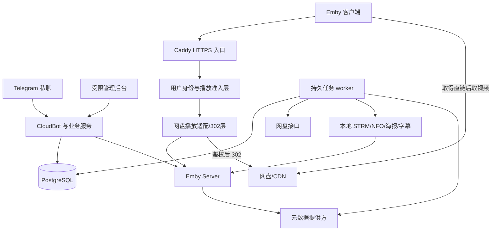

# 个人云盘 Emby 与 Telegram 服务完整优化方案

版本：4.0

日期：2026-11-13

现有美西2核2GB VPS＋网盘；签到积分/观影每20天可重选，积分/购买权益期间免保号。每日钱包随机10～20分，活动分固定；媒体闭环、随机积分精算、TG原型与完整运维设计见以下分篇。

本文件是设计；静态UI与积分模型已本地验证，真实Emby/网盘/支付/资源承载未部署或实测。价格与容量参数是提案。

## 分篇目录

- [01-总体架构与媒体自动化](01-总体架构与媒体自动化.md)
- [02-Telegram机器人完整功能](02-Telegram机器人完整功能.md)
- [03-注册保号积分商店与交易](03-注册保号积分商店与交易.md)
- [04-数据模型接口与一致性](04-数据模型接口与一致性.md)
- [05-部署运维容量与恢复](05-部署运维容量与恢复.md)
- [06-实施路线与验收](06-实施路线与验收.md)
- [07-资料核验与待定参数](07-资料核验与待定参数.md)
- [08-成熟方案对照与复用路线](08-成熟方案对照与复用路线.md)
- [09-安全码与TG内嵌管理面板](09-安全码与TG内嵌管理面板.md)
- [10-VPS资源识别限额与推荐](10-VPS资源识别限额与推荐.md)
- [11-备份恢复与跨平台迁移](11-备份恢复与跨平台迁移.md)
- [12-功能总表与版本变更](12-功能总表与版本变更.md)
- [13-Emby与自动追更最终实施规格](13-Emby与自动追更最终实施规格.md)
- [14-随机签到积分与续期测算](14-随机签到积分与续期测算.md)
- [15-TG面板UI与交互定稿](15-TG面板UI与交互定稿.md)

---

# 01 总体架构与媒体自动化

v4的媒体执行契约见[第13篇](13-Emby与自动追更最终实施规格.md)：当前由Emby负责元数据补缺；稳定取源入口必须真实可读，缺少现成映射时将内网OpenList作为所选方案依赖计入预算。

## 1. 定位与当前约束

这是一个由个人维护、可邀请他人使用的云盘 Emby 服务。首期目标是小规模稳定可用，同时把注册、保号、积分和购买规则设计完整。用户希望先得到完整方案，本阶段不把方案描述成已经可运行的成品。

现有美西 VPS 为 2核2GB。视频放网盘，本地保留媒体索引、海报、字幕、配置和业务数据；原文中的 30GB 磁盘容量仅作预算假设。目标规模先以 1～5 名实际使用者、1～2 路同时播放验证，不承诺相应并发上限。注册容量与同时播放容量分开管理。

第一阶段适合：普通视频直播放、有限目录的同步、单任务刮削、一个 Bot、少量用户权益维护。不适合在同机承担大规模转码、全库高频探测、大下载、自动下载全家桶和多个重复用户中心。

主要成功条件是四条独立链路都可验证：

| 链路 | 验证问题 |
|---|---|
| 用户→美西 VPS | 登录、海报、媒体库加载是否稳定？ |
| VPS→网盘 API | 列目录、授权、获取地址是否可靠？ |
| 用户→网盘 CDN | 实际客户端能否拉取、拖动、连续播放？ |
| VPS→Telegram/TMDB | 菜单、通知、元数据查询是否可靠？ |

美西服务器能访问网盘，并不能证明大陆客户端能播放。普通直播放也不能证明视频没有经过 VPS，必须验证 302 和网卡流量。

## 2. 功能边界与组件

| 层 | 首期选择 | 职责与边界 |
|---|---|---|
| 媒体中心 | Emby Server | 媒体库、用户登录、观看历史、收藏、播放器协议 |
| 网盘适配 | 一个验证通过的适配器；优先测试 OpenStrm | 目录差异、STRM、播放映射；不负责本项目积分与付费规则 |
| 用户业务 | Cloud Controller逻辑模块，优先在验证通过的Twilight扩展 | 唯一身份、权益、积分与任务写入者 |
| TG 入口 | CloudBot，与控制器同仓同业务模块 | 菜单、通知、管理命令；不单独维护另一份余额 |
| 数据库 | 单实例 PostgreSQL | 业务事实、事务、持久任务和通知发件箱 |
| 入口 | Caddy | TLS、反代、访问日志脱敏；不是自动获得 302 能力的组件 |
| 任务执行 | 控制器内后台 worker | 持久任务表、重试、单实例调度锁 |
| 按映射决定的依赖 | OpenList或已验证的现有可读来源 | 没有现成有效入口时优先验证内网OpenList；不遗漏资源预算 |
| 可选 | rclone、外部存活探测 | 异地备份与外部可用性监控 |

推荐业务代码采用 Go 模块化单体，减少进程和依赖数量；后台与 Bot 调用相同服务层。并非必须使用 Go，若采用其他语言仍必须满足本文事务和鉴权约束。PostgreSQL 初期一台一库即可，不把 Redis 作为正确性的必要条件。

v3复用优先：先验证Twilight固定版本，通过后作为唯一用户中心补充差异；不允许两套系统分别改到期或余额。若事务、权限、扩展或资源不符合，再切自建轻量Go单体。选型验证、AGPL许可与差距见[第08篇](08-成熟方案对照与复用路线.md)。[项目依据](https://github.com/Prejudice-Studio/Twilight)

## 3. 逻辑架构



首期先让现成播放适配器通过普通鉴权与播放测试。自定义“播放准入层”是后续开发模块，不是 Caddy 配几条规则就自动具备；在它完成前，设备上限只提供提示或审核，同播使用经验证的 Emby 原生能力或检测告警，不宣传硬限制。

公众只访问统一 Emby 域名；Emby 原端口、302 原端口、网盘管理端口都留内网。控制器通过内部 Emby 地址执行管理 API；普通用户凭据不得升级为管理员 API Key。

## 4. 两类播放路径

### 4.1 首选：直链重定向

1. 客户端登录 Emby，获取用户令牌。
2. 所有公开媒体 API 先经过统一入口；播放相关请求保留用户令牌、条目、设备与播放上下文。
3. Emby 按用户身份确认该条目可见；业务层确认权益、设备、同播准入。
4. 适配器把条目映射到网盘稳定文件标识，临时获取可播放地址。
5. 返回 302；客户端直接向网盘/CDN 请求视频。
6. 客户端继续向 Emby 上报播放进度，控制器做观影与会话统计。

OpenStrm 文档说明了 115 302、客户端访问其代理端口以及鉴权相关设置。本方案只把它作为候选基础，并要求固定版本进行准入与绕过测试。匿名重定向保持关闭；不能用服务器管理员密钥替无身份客户端解析直链。[项目说明](https://github.com/indown/OpenStrm)

STRM 是文本媒体入口，可以写 URL 或媒体路径；它不是视频，也不自带版权、鉴权、302 或直播放保证。[Emby STRM 文档](https://emby.media/support/articles/Strm-Files.html)

STRM 内优先保留稳定映射，例如内网文件入口或适配器支持的稳定路径。不要把几分钟后失效的网盘临时签名地址长期写入 STRM；也不要为所有用户共享一个长期免鉴权公网链接。若内网 `/d/` 入口必须关闭签名，网络层只允许 Emby/适配器访问，不能发布到公网。

### 4.2 兼容：受控回源

无法 302 的网盘、客户端或格式，需要决定允许回源、仅特定套餐允许、或直接提示不支持。回源时 VPS 承担视频流量，音频转码、封装转换和字幕烧录也可能让视频经过 VPS。

2GB 首期默认禁止视频转码，禁用自动回源到大量未知来源；音频转码也先关闭或严格限制到单任务，确认字幕格式和客户端解码能力。需要转码的资源应在入库前生成兼容版本，或等待有硬件加速的新节点。

不能把“Direct Play”“Direct Stream”“不转码”“302”混为一谈；每次验收记录实际来源、是否重定向、VPS 流量和转码进程。源必须支持正常 Range/206、拖动和断线恢复；短时 HTTP 检查与完整播放测试分别记录。

## 5. 302 的真实限制与取舍

- 直链签发后，客户端可在其有效期内继续读取；禁用账号、解绑设备、Bot 踢会话不能保证当前 CDN 请求立即停止。
- Device ID 和客户端名称通常由客户端申报，可复制；设备列表是软件身份管理，不是硬件认证。
- Emby 播放事件可丢失或伪造；只有观察数据，不能证明真人观看。
- VPS 看不到直链所有视频字节；不应按 VPS 网卡反推个人观影流量，也不能把会话统计宣传成 CDN 实际在线人数。
- 网盘若绑定 IP/UA/Cookie，必须分别验证 VPS 获取地址与客户端读取是否相容；不把 Cookie 下发给用户，也不通过轮换账号绕过限流。

本项目取舍：首期优先直链与低资源占用，接受可解释的软件限制。需要绝对连接数或带宽控制时改走受控代理，另算线路与费用；没有低成本兼得的承诺。

## 6. 网盘接入规范

初期只接一个现有网盘；若尚未持有，先用少量样片验证候选，再决定购买。海外网盘和对象存储仅作为扩展候选，不在此阶段做价格推荐。

每个账号保存能力档案：驱动/版本、授权类型、稳定文件 ID、目录枚举能力、增量游标、Range、直链时效、客户端必需头、跨 IP 可用性、字幕访问、并发/限流、风控状态、最近通过测试日期。

| 接入等级 | 允许用途 |
|---|---|
| A：客户端可直接取流，拖动稳定 | 默认主力播放源 |
| B：可取流但有 UA/IP/客户端限制 | 只开放已通过的客户端组合 |
| C：只能服务端代理 | 默认隐藏或按单独限额开放 |
| D：只能目录/备份访问 | 不进入可播放媒体库 |

OpenList 的存储驱动能力不能自动等同于 Emby 播放能力；rclone 的同步能力也不能替代授权与直链测试。[OpenList 驱动文档](https://doc.oplist.org/guide/drivers) / [rclone 文档](https://rclone.org/docs/)

同一个网盘账号全局串行或极低并发：目录、整理、转存、直链请求共用限流预算，播放签发高于后台扫描。遇到 429 服从 Retry-After；遇授权失效/风控暂停整个账号后台队列并告警，不逐文件不断重试。起始速率是本地保守设置，不是网盘官方许可配额。

## 7. 媒体目录与元数据归属

```text
/srv/cloud-emby/
  emby/config/                  # Emby 数据库、用户和配置
  adapter/config/               # 网盘适配器数据库与凭据
  controller/                   # 业务配置与运行目录
  media/staging/                # 半成品，不被 Emby 扫描
  media/published/Movies/
    示例电影 (2026) [tmdbid=123]/
      示例电影 (2026) - 1080p.strm
      movie.nfo
      poster.jpg
      示例电影 (2026) - 1080p.zh-CN.srt
  media/published/TV/
    示例剧集 (2026) [tmdbid=456]/Season 01/
      示例剧集 - S01E01.strm
      示例剧集 - S01E01.nfo
  postgres/
  backup-staging/               # 有大小上限，不等同异地备份
```

电影用名称＋年份，剧集用 SxxEyy。动漫记录绝对集数与季集映射；特别篇进 Season 00，合集、多集文件和分段电影单独标记，不能强行当普通一集。[电影命名](https://emby.media/support/articles/Movie-Naming.html) / [剧集命名](https://emby.media/support/articles/TV-Naming.html)

一个逻辑作品可包含多季集、多版本、多物理来源，去重按作品ID＋季集＋版本；同名不等于重复。v4首期由Emby负责元数据与图片补缺、保存到其配置/缓存，媒体工具只同步可信已有随片文件和规范命名。Emby媒体目录只读，关闭向该目录保存NFO/图片；未来改导入工具管理元数据时迁移所有权，禁止双写。人工锁定优先。

Emby 只读挂载 published；整理进程可写 staging/published。关闭昂贵的章节缩略图、视频预览与全量媒体深度分析，按需手动开启。图片限尺寸和数量，不能因影片在网盘就忽略本地海报占用。

## 8. 自动入库流水线

```text
发现变化 → 来源/季集校验 → 获取/转存完成 → 文件稳定检查
→ 生成STRM并同步已有随片文件 → 原子发布
→ Emby定向扫描与元数据补缺 → 确认条目可见
→ 轻量播放探测 → AVAILABLE（海报可暂缺）→ 合并通知
```

三个入口：自己上传/转存后的目录变化、已授权分享追更、管理员/求片任务选定的资源。TMDB 提供元数据，不提供视频文件；Sonarr/Radarr 如未来采用，也需要合法资源源与下载/导入链路，首期不部署。扫描已有网盘目录只会更新已有文件，不会凭空获得新集。

每步写持久状态与错误：`DISCOVERED / MATCH_PENDING / ACQUIRING / FILE_READY / PUBLISHED / INDEXED / AVAILABLE`；元数据补全单独状态。临时失败RETRY_WAIT，授权BLOCKED_AUTH，歧义MANUAL_REVIEW。INDEXED只代表入库，AVAILABLE代表当前测试链路可播放；其他客户端仍需验收，具体闭环见第13篇。

具体约束：

1. 上传完成以提供方完成标识为准；没有标识时两次目录采样大小稳定且可读作为弱信号，并标注未做全文件校验。hash 只有来源提供或实际计算过才能保存，不能从文件名伪造。
2. 识别先读 NFO/人工绑定 ID，再匹配名称年份、季集；模糊匹配进待确认。先预览后批量重命名，不执行自动删除冲突文件。
3. 索引及已有随片文件在staging完成后同文件系统原子rename，按版本清单发布；由Emby生成的元数据随后补缺，不把它误作发布前必需。失败保留旧索引。
4. 单个文件失败不阻塞全库；账号授权失效则暂停该账号所有任务。任务有幂等键 `(storage_account, remote_file_id, source_version, operation)`。
5. 扫描请求按目录合并，等待 60～120 秒再触发；优先目标目录/条目刷新。API 不支持局部操作时才批量全库扫描，不能每个文件扫一次全库。
6. API 接收刷新请求不等于完成，需轮询对应条目与任务状态。只有索引可见并通过探测后发“可观看”；否则显示“已同步，等待索引/待修复”。
7. 字幕先同步来源已有字幕；UTF-8 与语言后缀规范化、按季集/版本匹配。外部字幕下载仅在合法来源和授权配置完成后启用；不默认做 AI 转写。
8. 自动更新已有媒体时保留稳定标识与用户记录；路径大改需先验证 Emby 是否识别为原条目。替换后观影历史迁移不能凭方案保证，需样本演练。

## 9. 追更、缺集与资源替换

订阅记录作品 ID、期望季、已知总集数、更新源、语言/字幕要求、最高码率、当前版本、截止日期、申请者。允许只订阅后续通知，不自动取得文件。

新集到达只处理差异；重复事件通过幂等键跳过。季度结束后降频；连续失败到阈值进入人工处理。片源升级先建立新版本、验证播放，再切换默认来源；旧版进入至少 7 天隔离期，管理员确认后才清理。原网盘文件不由“清理本地索引”自动删除。

缺集分为“未播出、已播未找到、已找到未入库、入库失败、上游缺失”，不可把未知总集数当成缺失。用户能看到状态、最后更新时间和最近失败原因的友好摘要。

## 10. 调度与异常删除保护

| 任务 | 初期频率/并发 | 失败处理 |
|---|---|---|
| 增量发现 | 优先事件；无事件时 15～30 分钟，抖动 | 用游标续跑，不能假设断线期间事件保留 |
| 文件稳定采样 | 2～5 分钟，最多 1 个后台重任务 | 不稳定则延迟 |
| 刮削整理 | 单 worker，批量小任务 | TMDB 故障保留旧元数据 |
| Emby 扫描 | 发布后合并触发 | 超时转待查，不重新生成一切 |
| 目录完整对账 | 每日低峰，一次一小批 | 中断不推进完整扫描水位 |
| 缺集检查 | 每日 | 来源不可达则标未知 |
| 授权探测 | 30～60 分钟，复用近期成功信号 | 失效暂停，不无限重登 |
| 播放抽样 | 每日少量固定样片＋上次失败项目 | 用小 Range，避免全文件下载 |

扫描为空、授权失败、提供方超时都不能作为删除依据。文件缺失先标 `SUSPECT_MISSING`，至少两轮完整成功扫描确认、相隔至少 24 小时，再隐藏；默认保留本地索引 7 天。若缺失比例超过 10% 或某根目录突然消失，触发全局删除熔断并人工确认，不能传播成全库清空。

## 11. 可见性与服务降级

普通用户只看到有权访问的库与版本；来源 Cookie、网盘账号、内部路径不公开。某网盘故障时展示“来源维护中”，同作品有已验证替代源时可供选择，不在正在播放中无条件无缝换源。

控制器故障与网盘故障分开处理：已经授权的播放尽量继续；新播放按缓存策略有限放行或拒绝；注册、兑换、扣积分和支付履约必须暂停到数据库可用。具体故障策略见运维文档。

---

# 02 Telegram 机器人完整功能

## 1. 产品结构

首期一个 CloudBot，私聊承担用户自助与管理员入口；公告群/频道仅推送脱敏入库与维护消息，是否建群可选。账户、密码、订单和兑换码仅私聊处理。Bot 是入口，所有决定由业务服务完成，按钮文本、聊天状态和客户端传入价格都不是可信依据。

推荐主菜单：

TG内嵌Mini App面板、安全码与恢复见[第09篇](09-安全码与TG内嵌管理面板.md)，原生命令保留作为兼容入口。

```text
🎬 我的 Emby                  📡 服务器与线路
👥 在线状态                   📱 我的设备
🛒 商店                       🎟 兑换中心
📅 签到与保号                 💎 我的积分
🔍 搜索/求片                  🔔 通知与订阅
🧾 订单与权益                 🛟 帮助与工单
```

未注册显示“注册/绑定已有账号/使用说明”；已注册但未开通显示注册结果、开通方式与服务状态；冻结用户仍可查看自己的订单、保号、退款和客服入口。管理员增加独立“管理中心”，不与用户命令含义冲突。

## 2. 命令与按钮覆盖

| 命令 | 功能 | 可用身份 |
|---|---|---|
| `/start`、`/menu` | 首页与当前可执行操作 | 所有人 |
| `/register` | 按当前策略注册，显示开放/邀请/购买路径 | 未注册 |
| `/bind` | 绑定已有 Emby 账号 | 未绑定身份 |
| `/account`、`/info` | 账号、播放权益、账号保留、最近同步状态 | 本人 |
| `/servers` | 地址、端口、线路、复制信息、使用教程 | 已绑定；按权益过滤 |
| `/online` | 全服聚合在线/播放数与更新时间 | 已注册 |
| `/devices` | 自己的设备列表、重命名、解绑 | 本人 |
| `/sessions` | 自己的播放会话、请求停止 | 本人 |
| `/password` | 发起短时网页密码重置 | 本人 |
| `/checkin` | 当日签到、积分、周期进度 | 本人 |
| `/keep` | 所选模式、20天进度、免保号区间和结算 | 本人 |
| `/keepmode` | 选择/预约下个20天窗口的活动模式 | 本人 |
| `/panel`、`/security` | 内嵌面板、安全码与恢复设置 | 本人 |
| `/points` | 可用/冻结积分、流水、规则 | 本人 |
| `/shop`、`/plans` | 商店与商品筛选 | 已注册或购买注册访客 |
| `/buy`、`/renew` | 选商品、确认权益变化 | 有购买资格 |
| `/redeem` | 使用卡码；积分兑换在商店选择 | 本人 |
| `/orders` | 订单、履约、退款、补发 | 本人 |
| `/search`、`/request` | 搜索库存、求片、订阅 | 有相应资格 |
| `/requests` | 我的求片和跟进记录 | 本人 |
| `/notifications` | 通知开关、静默时段、订阅 | 本人 |
| `/status` | 服务维护/故障状态，最后更新时间 | 所有人，信息脱敏 |
| `/help`、`/support`、`/paysupport` | 教程、工单、支付问题 | 所有人 |
| `/privacy`、`/terms`、`/cancel` | 数据说明、规则、取消当前交互 | 所有人 |
| `/admin` | 管理员入口 | 授权 TG 数字 ID |

命令别名只转发到一个实现；例如 `/info` 与 `/account` 不各维护一份逻辑。用户中心的“兑换码”与商店的“积分兑换”要用不同按钮文案。

## 3. 我的 Emby 与账号资料

建议页面：

```text
账号：demo_user      UID：U10001
绑定：已绑定 Telegram；Emby 同步正常
播放：活动成员 / 本期至2026-12-03 00:00（北京时间）
保号：签到积分模式，20/20活动分；12月3日可切换下期
资料：到期/冻结后至少保留30天；免保号权益另列
设备：2/3 台        同时播放：1/1 路
积分：可用 260，冻结 0
```

示例只演示字段，实际截止时间由业务规则计算。按钮包括服务器地址、修改密码、设备、保号、续期、通知设置、绑定管理。若控制器已记录续期但 Emby 尚未同步，显示“权益已到账，正在同步”，不能显示“已可播放”。

不显示已有密码；用户中心不保存可恢复的 Emby 明文密码。用户名的更改默认人工审核，避免客户端配置、历史和对账关联受影响。业务 UID 不随 TG 用户名、昵称、Emby 名称改变。

## 4. 服务器地址与线路

每条线路配置：显示名、协议、主机、端口、用途、可用客户端、适用区域、权益要求、维护状态、优先级、最后健康时间。首期只有一台 VPS、一条可用线路也应如实展示，不把相同后端的多个域名描述成独立节点。

页面提供：

- 推荐 HTTPS 地址，独立复制主机与端口，说明客户端是否填写完整 URL。
- 备用入口与当前状态；只有确实存在独立容错路径才称为备用线路。
- Android、电视、Windows、iOS 等设置教程；客户端付费/解码能力以所用版本为准。
- “刷新线路”按钮，缓存 30～60 秒；“报告无法连接”携带脱敏线路 ID。
- 带条目 ID 的 Emby 跳转链接可选；第三方客户端深链接需逐个测试，失败保留普通地址。

地址仅下发给符合相应可见性资格的用户，但隐藏地址不是安全边界。登录鉴权、库权限与播放授权始终独立检查。健康检测只说明探针位置可达，不能标成“你本地一定最快”。

## 5. 在线人数与当前播放

必须同时说明口径、采样时间、数据来源与缓存状态：

| 指标 | 定义 |
|---|---|
| 注册用户 | 业务身份总数，非当前在线 |
| 可用用户 | 当前有播放权益且未被封禁的独立 UID |
| 在线用户 | 最近 5 分钟有 Emby 会话活动的去重 UID；无活动字段时标“可见会话用户” |
| 播放用户 | 最近 90 秒有有效播放活动的去重 UID |
| 播放会话 | 最近 90 秒未暂停且进度有变化的独立播放实例 |
| 已占名额 | 播放准入租约数，可能包含短时暂停/待清理租约 |

普通用户示例：“在线用户 6 · 正在播放 3 人 / 4 路 · 数据截至 20:31:12 · 约 30 秒刷新”。仅展示聚合数；不列他人的片名、TG 身份、IP 或设备。管理员按权限可查看详情，日志保留访问审计。

Emby 接口超时显示“暂无法获取，上次数据为……”，不能显示 0；302 没有进度回报时提示统计可能缺失。设备已登录、暂停、封面浏览与有效观影均不得混算。

`/sessions` 显示自己的条目标题、客户端、播放/暂停、进度、最后心跳，提供停止请求。停止调用成功只表明控制命令已发出；已签发 CDN 直链可能继续，页面如实说明，不能承诺秒踢。

## 6. 我的设备与解绑

每台设备显示用户自定义名称、客户端/版本、首次授权、最后活跃、已授权/待审/已撤销、是否有播放。IP 默认只显示模糊区域或掩码，定位为可选信息，不精确追踪。

新设备流程：识别 Device ID→检查该用户已授权设备→有空位则首次自动授权并通知；已满则拒绝新播放并提示解绑旧设备，不能自动覆盖旧设备。对无法可靠识别 Device ID 的客户端进入待审或受限模式，不能当无限新设备。

用户操作：设备重命名、查看近期登录、解绑单台、申请全部重置。初始建议每滚动 7 天 2 次自助解绑、单台解绑后 24 小时内不重复换绑；这些值可调。失窃设备允许管理员豁免冷却并留原因。解绑确认页说明关联播放、授权令牌撤销结果和剩余配额；能撤销 Emby token 时撤销，不能时只声明业务入口已拒绝后续请求。

IP 变化不自动解绑或扣分；同一家庭 NAT 与移动网络经常换 IP。Device ID 不是硬件防伪凭证，风控只辅助人工判断。设备包增加的是授权设备数，不增加同播路数。

## 7. 修改密码、绑定与恢复

首选短时 HTTPS 页面：

1. 用户在私聊点击修改密码。
2. 控制器校验身份、状态、限频，生成 5 分钟一次性操作票据；数据库只存哈希。
3. Bot 发送“打开重置页面”按钮，URL 使用短时票据；页面禁第三方统计、`Referrer-Policy: no-referrer`、`Cache-Control: no-store`，访问日志不保存票据。
4. 打开链接不消耗票据，防止聊天预览预取；页面确认 POST 才消耗。页面要求通过服务器验证的 Telegram 身份确认，不能只凭 URL 即任意改密；初期可使用网页与原私聊双通道确认。
5. 用户输入新密码并再次确认，服务端临时传给 Emby 设置，结果入审计但绝不记录明文；撤销旧登录按 Emby 版本能力执行并核验。
6. 成功通知本人，提醒电视等客户端重新登录。票据失败/超时需重新申请，不在 Bot 返回新密码。

首期开通同样用设置密码页面完成；页面未完备时仅管理员安全开通，不让用户把旧密码发送到聊天里。TG 私聊不能被当成端到端秘密通道。

绑定已有账号：对已登录 Emby 会话做身份挑战或管理员审核，禁止只凭填写用户名就绑定。TG 换绑必须原身份确认＋新身份确认；原身份丢失走一次性恢复码/人工工单，订单截图不作为唯一身份凭据。一个 TG 数字 ID 默认只能绑定一个本服务身份；用户名变化不触发解绑。

## 8. 签到与保号页面

显示所选模式、20天周期、活动分、钱包、有效观影、下次可选时间、下期预约及免保号截止。钱包被消费不减活动分，管理员加钱包不代替签到活动。

```text
本周期：11月13日—12月3日 00:00（北京时间）
当前模式：签到积分；活动分10/20，钱包260分
观影仅显示记录，不替代所选签到模式
当前结果：尚未达标
[今日签到] [预约下期观影] [积分月/年卡] [购买免保号播放]
```

点击保号不直接伪造通过。兑换或购买月/年卡生成独立限期免保号播放，有效期显示免考核，不催签到/观影，可自愿签到和追加兑换。20天预约切换不抹掉旧义务，具体以第03篇为准。

详情展示观影证据的日期/有效分钟，不暴露内部 API Token。统计故障说明“观影统计延迟，清退已暂停”，提供申诉，绝不让系统故障变成强制购买。

## 9. 积分、商店与兑换中心

积分页显示可用、冻结、即将过期（首期积分默认不过期）、最近流水、获得与消耗规则。每笔有业务原因和引用号，补偿明确标为冲正，不覆盖原账。

商店分活动权益、积分月季年卡、购买与礼品卡；按身份、容量、库存过滤。显示播放时长、免保号、是否仅资料保留、设备/同播、生效/到期、限购、退款及支付开关，先预览再下单，不因重复点击扣款。

兑换中心支持注册资格码、播放时长码、保号码、积分码、设备包码；只有兑换成功后才消耗，受有效期、领取人、批次和使用次数约束。卡码回显仅末 4 位，失败不披露是否被某个他人使用。

订单页区分待付、支付确认、权益交付、交付重试、已退款；提供刷新、取消未付订单、支付问题和补发通知。重发消息不重新发权益。经济规则详见第三篇。

## 10. 搜索、求片与追更

查询先搜有权访问的本库，再搜元数据；结果显示片名、年份、类型、海报、季集、版本/字幕、可用/处理中。库存匹配需限定服务和库权限，不能把别的服务里有片当作当前可播放。

求片流程：选明确作品→选季集/画质/字幕→查重复申请→扣配额或冻结求片积分（若启用）→审核→获取→整理→验收→通知。默认不扣积分、每人每周最多 3 个新请求；重复作品可“加入关注”而不重复建任务。拒绝给理由，无法取得资源不承诺期限。

支持“缺集补报”“字幕问题”“播放失败”“匹配错误”，自动附加媒体 ID、客户端类型和时间，禁止收集完整播放 URL 中的 token。用户可以订阅作品后续更新、取消自己的未处理申请；管理员需在获取中取消时说明已发生任务的处理。

## 11. 通知、帮助与工单

强相关通知：开通/续期结果、密码/绑定变更、支付/退款、设备异常、保号截止、故障处理。营销和泛入库通知默认关闭；求片/追更定向通知默认开启，可取消。安全通知尽量保留，无法发送时在账户中心展示。

默认提醒时间：周期截止前 7/3/1 天、播放权益到期前 3/1 天、冻结时和恢复时。已达标、已续费或享有保护的用户不再收到过期提醒。重复通知按 `(用户,事件类型,周期/订单,提醒阶段)` 去重；22:00—08:00 为可配置静默时段，安全及支付结果可即时发送。

批量入库以 10 分钟窗口合并，每部作品一条，频道每日摘要优先。发送失败按 Telegram 返回限流时间重试；用户屏蔽 Bot 标为不可达，停止反复发送，不因屏蔽直接删账号。

帮助包含客户端设置、外置字幕、无法播放、为何不支持转码、在线统计口径、保号例子、兑换规则、退款、隐私与维护状态。工单有编号、类型、状态、处理记录；客服只能查本工单必要数据。

## 12. 管理员能力与权限

| 模块 | 操作 |
|---|---|
| 总览 | 健康、容量、用户/播放、任务积压、失败履约、当日积分与订单异常 |
| 用户 | 审核、查 UID、赠送时长、冻结/恢复、重同步、设备重置、换绑审核 |
| 注册 | 开关模式、名额、邀请批次、每日配额、候补、暂停原因 |
| 保号 | 所选模式、20天锁定/预约、免考核区间、活动证据、事故豁免 |
| 商店 | 商品草稿/发布/下架、库存、价格/规则版本、生效预览 |
| 财务 | 对账、履约/退款、单用户积分加减/设置目标/冻结/冲正、卡码批次 |
| 媒体 | 求片审核、匹配修正、追更、任务重跑、缺集、坏链与隔离恢复 |
| 网盘 | 健康、限流、授权即将失效、暂停任务；凭据仅后台录入 |
| 运维 | 健康、日志摘要、备份结果、恢复演练记录、维护模式 |
| 审计 | 查询操作者、对象、前后变化、原因、关联流水与 Trace ID |

Owner 管规则与凭据；Operator 管媒体与故障；Support 处理工单和脱敏账户查询；Finance 处理订单/退款，无网盘凭据权限。权限使用后端 RBAC，不能只隐藏按钮。管理员用 TG 数字 ID 允许名单；Web 后台加独立强认证。

批量冻结、规则发布、积分调整、退款、账号删除都有数量与效果预览和短时确认。常规用户点击无需反复确认；危险操作才确认。Bot 不提供任意 shell、任意数据库 SQL 或一键拉最新镜像并重启所有服务。

## 13. 交互与可靠性规范

- 所有回调都重新读取操作人 TG ID、对象归属和最新权限；转发消息、旧按钮、篡改 callback 都不能越权。
- 回调载荷只放短不透明引用，真实订单/金额/权限从服务器读取。一次性确认引用与操作者、动作、对象、版本、有效期绑定。
- 收到按钮先及时回应，再将长任务入持久队列；用进度页或结果通知，不让一个网盘请求阻塞所有聊天。
- 多步输入可取消，10 分钟过期；超时回到菜单，不把之后一句聊天误当兑换码或密码。
- 查询结果短缓存；注册、积分、订单和保号写操作全部幂等。Telegram 更新重复投递不能发两次权益。
- 长列表分页；旧页刷新时再次鉴权；错误回复用户可读原因和引用号，堆栈/密钥只留脱敏日志。
- 新消息与修改原消息策略统一；旧按钮显示过期并提供最新入口。并行点两单仍受余额、库存和名额事务约束。

Telegram 支持轮询和 Webhook 两种互斥接收方式；首期单实例使用轮询，更新先持久化后推进 offset，发送和业务事件单独重试。Webhook 迁移时校验官方 secret header。回调长度与数字 ID 存储遵循官方定义，具体实现前复核所用 API 版本。[Bot API](https://core.telegram.org/bots/api)

---

# 03 注册、保号、积分、商店与交易规则（v4）

本篇按用户最新要求重设，取代v2的“四条路径按同一周期任选达标”。现在是**活动保号二选一＋限期免保号权益优先**。20天选择间隔是用户要求；下面积分、观影量、商品价格和宽限天数为可调整提案。时间存UTC、显示北京时间，日界使用Asia/Shanghai。

## 1. 身份与权益分层

身份UID、注册资格、Emby账号、活动保号模式、有效播放权益、资料保留期限分别记录。

| 对象 | 含义 |
|---|---|
| 业务身份 | 绑定TG数字ID；昵称和TG用户名不是身份凭据 |
| 注册资格 | 开放、邀请、购买注册，不自动等于无限使用 |
| 活动模式 | CHECKIN_POINTS签到积分保号，或WATCH观影保号 |
| 免保号播放 | 积分兑换、购买、管理员授予的限期播放权益 |
| 纯资料保护 | 只保留账号、收藏和记录，不提供播放、不代替活动考核 |
| 安全封禁 | 优先于普通权益；需按原因处理，不靠购买自动解除 |

免保号指“有效期内不要求签到、不要求观影”，可自愿签到赚积分；不豁免设备、同播、媒体库、全服容量和安全限制。“播放月卡”和“资料保留卡”必须分开。

## 2. 注册路径与容量

OPEN、INVITE、PURCHASE支持独立或组合开启。默认邀请制，后台可切开放；购买注册在支付与履约验收后开启。总注册、活跃成员、各路径预留席位、每日额度、人工审核分别配置。

| 路径 | 步骤 | 限制 |
|---|---|---|
| 开放 | 私聊确认规则→身份验证→审核或自动开通 | TG身份唯一、每日额度、总容量 |
| 邀请 | 邀请引用→核验批次/有效期→预留→开通 | 次数、指定领取人、邀请者限额 |
| 购买 | 访客身份→名额预留→付款→创建账号与权益 | 不允许无容量仍保证立即开通 |

TG接口不能可靠提供账号注册年龄，不能虚构“账号满30天”的自动认证。反滥用采用邀请、审核、挑战与节流。内测可暂设总成员20、每日成功注册3、待履约预留2，均是节流参数，不是2GB承载保证。

事务预留名额/邀请码、创建成员及开通任务；worker异步创建Emby、保存映射、设置策略和密码。创建超时先查证，避免重复；不因同名认领外部已有用户。注册用户设置密码、安全码与恢复码的流程见第09篇。

首次免费开通选择签到或观影，显示目标、截止和下次可选择时间。积分/购买直接开通免保号用户可只保存期满偏好，无需先完成活动。

## 3. 每20天重新选择活动模式

默认活动考核窗口和模式锁定窗口均为20×24小时，区间[start,end)。首次选择后本期锁定；每满20天有一次新选择机会。

- 可在截止前预选下期模式；预选只是预约，最早在20天边界生效，不解除当前要求。
- 未重选沿用上期模式；新一期开始后申请切换，预约到下一个20天边界，面板写明生效时间，不能缩短当前考核期。
- 一期只按所选模式考核。选签到，即使看30分钟也不自动转换；选观影，签到可赚积分，但不替代观影。
- 切换不清空钱包、不重置结算、不发体验时长；同一窗口只有一个最终生效版本。
- 生效前可改下期预约，生效后锁20天。管理员因误选/事故可豁免并留原因，不能把换方式变成隐性收费。
- 如将来提供“中途切换但不重置截止”策略，需单独配置；首期采用边界切换。

20天是活动节奏，30天月卡/365天年卡是权益时长，不能共用同一expiry字段。

## 4. 签到积分保号

每日签到同时产生**可消费积分**和**本期签到活动分**。后者只是考核进度，不是第二个可交易钱包。

默认北京时间每天首次签到随机＋10～20钱包积分（整数等概率，均值15），固定＋10活动分；20天内活动分≥20通过，相当于2个不同自然日。随机只影响钱包，不影响活动公平性。细算见[第14篇](14-随机签到积分与续期测算.md)。

活动分只来自本期有效签到；管理员加钱包、兑换码入账、消费返还和上期余额不伪造活动。积分花掉不影响本期已达标。同日重复不加分；免保号用户可签到入钱包，但不创建必须完成的考核。

连续奖励是否计入活动分须单独设置，首期关闭倍增。每日积分上限、会员奖励覆盖与封禁规则均前置说明，不追罚正常所得。

## 5. 观影保号

默认20天累计有效视频进度30分钟。排除暂停、预告、浏览、音乐和拖到片尾；“标为已看”不计时长。观影奖励积分可配，首期关闭，减少挂播放刷分。

采集经认证的Emby事件/扩展插件，以Sessions采样交叉检查，记录播放实例、用户、条目、设备、位置、速率和时间。相邻可信样本最多90秒，近似累计min(墙钟间隔,可验证速率换算后的正向进度增量)，突跳/倒退不计跳跃部分；每段至少连续120秒，多设备重叠时段取并集。

事件按唯一ID去重，最多24小时迟到窗口重算；未知时钟/心跳缺失不强行推导完成。302缺回报时显示统计盲区，可下期换签到，当期可申诉，不能强制购买。采集连续故障10分钟则暂停受影响活动冻结，延期故障时长＋24小时缓冲并留事故记录。

## 6. 免费结算、宽限与恢复

免费用户获首个20天活动播放期，所选模式达标后续下20天。结算先处理截止前可信事件和系统健康，再按模式判断。

```text
安全封禁 → 拒绝播放，进入安全处理
否则存在有效免保号播放grant → 正常播放，不考核签到/观影
否则Owner显式免活动授权 → 按授权播放
否则按本期selected_mode：
  CHECKIN_POINTS → cycle_checkin_score >= threshold
  WATCH → cycle_valid_watch_seconds >= threshold
```

未达标进入7天宽限。v3默认在容量许可下发一次明确的7天宽限播放grant，让观保用户仍可补救；保持原设备/同播上限。这取代v2的“宽限不播放”。

宽限补救仍按旧模式，可计入宽限内活动，记为rescue而非伪造截止前活动。成功后恢复旧截止起算的下20天，不按补救日不断顺延。宽限grant每周期仅一次，不递归。若紧急容量不允许宽限播放，暂停该用户活动冻结并人工处理，不能不给观影又据此处罚。

补救签到/观影只能归属旧周期，不能同时给下一期计分。旧义务完成后才激活已预约的新模式，从补救完成后累计下一期活动，下一期截止仍不顺延；面板预先提示剩余考核时间。这样一次宽限观影不能同时换到两期通过。

宽限后未完成进入FROZEN_INACTIVE，保留资料至少30天，Bot/客服可用；默认不物理删除。免费恢复检查席位和频率；积分兑换或购买免保号可恢复普通不活跃冻结，不能解除安全封禁。预约下期模式不抹掉旧期义务；先旧期补救或兑换免保号恢复。

更严规则默认新周期生效，保留policy_version，不回溯清退。

## 7. 积分兑换月、季、年

起步提案全部可由面板调整，已下单价格与效果不变：

| 商品 | 提案积分 | 时长 | 有效期间 |
|---|---:|---:|---|
| 积分月卡 | 300 | 30天 | 可播放，免签到，免观影 |
| 积分季卡 | 850 | 90天 | 同上 |
| 积分年卡 | 3000 | 365天 | 同上 |

随机10～20分/日，从零余额首次攒够月卡期望20.4889次、季卡57.1556次、年卡200.4889次，不含消费/赠送。月卡22次达标概率98.0433%，30次保证；平均不是保证。本期20活动分只是免费考核目标，不自动送月卡。

兑换生成EXEMPT_PLAYBACK grant，来源POINTS，含有效区间与免活动属性，不是给本期打勾。已免保号仍可继续签到、主动兑换续期；重复点击同一订单不双扣，明确另下单可追加。

自动积分续期默认关闭，需全局许可＋管理员对用户许可＋商品可售＋用户同意＋余额/容量足够；指定窗口只扣一次，可撤回授权。安全封禁、手动停用、争议、永久账号不自动扣。

## 8. 购买和积分同层豁免

购买月卡/季卡/年卡同样生成免活动播放grant，仅来源不同。管理员可授予限期或永久免保号并留原因。免保号不是无限设备或无限同播。

同档积分与购买时长进入顺延队列：新grant起点=max(now,已有连续免保号覆盖终点)，终点=起点＋时长。每单保留独立区间，退款可精确撤销。跨档默认期满换档，复杂中途差价暂不提供。

开始免保号关闭免费周期为SUPERSEDED_BY_EXEMPT，保留积分/活动，不再生成义务、不追讨旧普通不活跃周期。结束后已有免费回退席位且策略允许，则从结束时开启完整20天活动窗，沿用偏好并提示可重选；不倒扣豁免期间活动。用户可选择“仅续免保号，不回免费”，到期只保留资料。

免费回退席位在售卖/兑换时明确保留。后台降低容量先停新注册，不随意取消既有承诺。周期选择锁定在重新进入活动时开始新的20天，不要求用户追溯切换。

## 9. 实例

假设首期2026-11-13 00:00至12-03 00:00，北京时间：

| 场景 | 结果 |
|---|---|
| 选签到，14日和15日各签 | 20活动分通过，钱包随机共＋20～40 |
| 上期钱包有1000分，本期未签 | 钱包不代表本期活动；可主动兑换免保号 |
| 选观影，仅签两天没看 | 钱包随机＋20～40，观影仍未达标 |
| 12月2日预约观影切签到 | 最早12月3日生效，旧期仍按观影 |
| 11月15日申请切换 | 显示锁定和12月3日生效，不重置 |
| 11月20日300分兑月卡 | 当日起30天免保号，旧活动周期关闭 |
| 月卡期再购年卡 | 同档顺延365天，不让两笔重叠浪费 |
| 免保号中自愿签到 | 可赚积分，没有活动义务 |
| 免保号结束 | 新20天活动窗，沿用/重选，不算过去欠账 |
| 普通冻结后兑年卡 | 恢复365天免保号，历史保留 |
| 只购资料保留90天 | 不删除资料，不自动有播放 |
| 观影采集事故 | 暂停受影响冻结并延期，不强制消费 |

30天为30×24小时、365天为365×24小时，避免自然月/年歧义。

## 10. 管理员单用户设置

支持加分、减分、设置目标可用余额、冻结/解冻、冲正、单用户签到奖励、兑换价格覆盖、活动阈值、免保号、自动续期许可、设备/同播/库权限覆盖及期限。覆盖显示来源和优先级，到期回套餐规则。

“设为1000分”先锁账户，计算delta=1000-current_available并新增ADJUSTMENT流水，不覆盖历史。负余额不允许；有冻结金额时仅改可用部分，界面同时显示可用/冻结/总额，不抹掉正在履约的冻结。

请求携带expected_account_version与预览余额；并发签到/消费改变version则重新预览。每笔有操作者、原因、工单/事故、前后值、幂等键；大额/批量需Owner二次验证，可配双人复核，客服无改分权。

账本是真相，余额是快照。兑换锁余额/库存/配额，扣分、发grant、写outbox同事务，失败不扣、通知失败不撤销权益。管理员改钱包不代表活动通过；补救用单独豁免。

## 11. 商店与卡码

商品分免保号播放、资料保留、设备、同播、求片配额、注册资格、礼包。版本写明价格单位、效果、身份/容量、起止、库权限、豁免、限购、退款和自动续期资格。v2的200积分本期打勾商品在v3下架。

设备包不增同播，过期保留记录，用户选保留设备，超额设备不准新播放。总同播包必须全服/节点/网盘/用户准入与压测完成再售；302不能绝对立即断流的限制继续说明。

码用高熵随机值，仅存哈希/HMAC；支持批次、有效期、指定人、总次数/单人次数、撤销。事务核验→占用→发grant/积分→claim→提交，失败不耗码。统一失败提示防枚举，不泄露他人；播放码不绕过注册，除非明确含资格。

## 12. 支付、履约与退款

真实支付首期关闭。Telegram内数字服务按Stars/XTR，不以外链收款替代；销售前明确许可、来源、服务范围、退款及支持。[Telegram数字商品支付](https://core.telegram.org/bots/payments-stars)

订单快照商品/规则/价格/效果并预留容量；价格由服务端算。pre-checkout在官方时限内验证身份/金额/币种/容量，不等Emby创建。只有验证过的成功支付入账，charge_id唯一；预支付不是成功。

重复回调只发一份；本地订单超时后真实付款仍入账并履约/退款，不能丢款。Emby故障保留DELIVERY_RETRY，不要求重付。每天渠道/订单/退款/grant对账，通知失败独立补发。

订单CREATED/AWAITING_PAYMENT/PAID/CLOSED，支付PENDING/SUCCEEDED/REFUND_PENDING/REFUNDED，履约PENDING/APPLYING/APPLIED/RETRY_WAIT/MANUAL_REVIEW分开。

首期全单退款；撤销对应独立grant并重算后续，不用“当前到期减30天”误伤其他单。积分失败退还用冲正流水，不提供无限已使用卡退换套利。支付退款超时先查证，唯一退款号防重复，退款后重同步Emby、通知并对账。

## 13. 迁移后的延续

保留周期边界、模式锁定、下期预约、签到活动分、钱包账本、免保号grant、自动续期授权、安全码哈希和用户覆盖。不能迁移后清锁定重新刷体验，不能旧快照覆盖近期兑换。恢复先关支付/自动扣分/冻结，对账后开worker；换Bot Token不改内部UID。第11篇给出完整迁移方案。

---

# 04 数据模型、接口、安全与一致性

## 1. 开发结构与责任

建议一个代码库，按 identity、registration、entitlement、retention、points、commerce、devices、media、notification、admin、integration 模块划分。Bot、Web 和定时任务都调用服务层，不能各自实现余额或到期逻辑。主程序与 worker 可以同进程启动，仍使用持久任务和互斥租约，未来可拆为独立 worker。

本篇是开发契约，不是已经存在的 API。数据库迁移、错误码和适配器版本须在实施时落地；第三方接口以固定部署版本的实际 API Browser/源码为准。

v3优先在通过准入验证的Twilight同一业务服务内扩展这些契约，接口并非宣称Twilight原生存在；不符合时才采用自建单体。活动选择、免保号、安全、容量与迁移分别参见第03/09/10/11篇。

## 2. 核心表与唯一约束

所有业务表使用内部 UUID/有序 ID、`created_at/updated_at`；金额和积分用整数，时间用 `timestamptz`。状态枚举受约束，策略与商品使用不可变版本快照。

| 表 | 关键字段与约束 |
|---|---|
| `identities` | uid、telegram_id BIGINT UNIQUE、昵称缓存、状态；昵称不做认证 |
| `services` | 服务ID、显示名、内部Emby地址引用、节点/版本、维护模式 |
| `memberships` | identity_id、service_id UNIQUE、free/paid模式、审核状态、冻结原因 |
| `emby_accounts` | membership_id UNIQUE、emby_user_id、用户名、创建操作ID；服务＋emby_user_id UNIQUE |
| `registration_policies` | 版本、可用路径、容量、每日额度、生效时间、审批要求 |
| `invitations` | 哈希、批次、邀请者、使用上限、有效期、撤销状态 |
| `registration_reservations` | 身份、路径、名额、邀请占用、到期、关联订单；活动预留唯一 |
| `policy_versions` | 完整规则快照、发布时间、操作者、适用周期 |
| `entitlement_grants` | 类型、有效区间、播放/设备/同播/库权限、来源订单或卡码、撤销引用 |
| `effective_entitlements` | 计算快照、版本、播放到期、保护到期、配额；可重建，不是原始事实 |
| `retention_cycles` | membership、start/end、策略版本、状态、截止提醒水位；成员＋周期起点 UNIQUE |
| `retention_mode_selections` | 所选CHECKIN_POINTS/WATCH、生效/锁定至、下期预约、操作者、策略；有效窗口唯一 |
| `checkins` | member、北京时间date、cycle、固定活动分、随机范围/实际钱包奖额/规则与个人覆盖快照、流水引用；成员＋日期 UNIQUE |
| `checkin_activity_scores` | 签到来源、周期、活动分；来源唯一，不随钱包消费/人工调整而变 |
| `watch_events` | 来源事件唯一ID、播放实例、用户、条目、设备、位置、速率、采样时间 |
| `watch_intervals` | 去重后的有效区间、采样质量、周期归属；来源可追溯 |
| `retention_qualifications` | cycle、方式、引用、达标时间、补救标志；来源引用 UNIQUE |
| `points_accounts` | 用户、可用/冻结快照、version；用户 UNIQUE |
| `points_ledger` | 整数增减、冻结/释放/消费类型、业务引用、冲正引用；幂等键 UNIQUE |
| `products/product_versions` | SKU、单位/价格、效果、库存、限购、状态、版本 |
| `orders/order_items` | 下单者、商品/政策快照、币种、金额、状态、客户端幂等键 |
| `payments` | 渠道、charge_id UNIQUE、订单、金额、状态、去敏事件摘要 |
| `fulfillments` | 订单项 UNIQUE、履约操作ID、状态、重试、发放grant引用 |
| `refunds` | 退款号 UNIQUE、支付、金额、原因、状态、撤销grant引用 |
| `redeem_codes/claims` | 码哈希 UNIQUE、效果、限制；码＋领取者/次数约束 |
| `devices` | membership、device_id摘要、客户端、授权状态；成员＋设备摘要 UNIQUE |
| `playback_leases` | 用户、播放实例、设备、有效截止、策略版本；播放实例 UNIQUE |
| `server_endpoints` | 线路、协议、端口、权限条件、健康、优先级 |
| `storage_accounts` | 驱动、密钥引用、能力档案、健康、限流、游标；不存明文日志 |
| `media_items/episodes/variants` | 元数据ID、季集、版本规格；作品ID＋媒体类型 UNIQUE |
| `media_sources` | variant、账号、文件ID、版本、路径、大小；账号＋文件ID＋版本 UNIQUE |
| `published_indexes` | 来源、STRM路径、发布版本、Emby条目ID、状态、校验时间 |
| `media_requests/followers` | 作品/季集目标、审核/获取状态、申请者；相同目标合并关注 |
| `jobs` | 类型、幂等键、payload引用、状态、run_after、尝试数、锁租约、最后错误 |
| `inbound_updates` | Bot ID＋update_id UNIQUE、状态、接收时间；敏感原文最小化 |
| `outbox` | 事件ID、通知/同步类型、对象、目标版本、状态、重试；业务引用 UNIQUE |
| `audit_events` | 操作者、动作、对象、前后摘要、原因、请求/事故引用 |
| `support_tickets` | 用户、类型、状态、必要诊断、处理记录、数据保留期限 |
| `security_credentials/recovery_codes` | 安全码哈希/算法、credential_epoch、限流；恢复码哈希及消费/撤销，不存明文 |
| `user_policy_overrides` | 作用域、覆盖值、有效区间、原因；不能突破全局硬限制 |
| `capacity_policies/node_snapshots` | 全服/节点/来源硬限制、已应用版本、有效资源、采样范围和时间 |
| `capacity_recommendations` | 证据、建议范围、可信度、缺失项、批准/执行/回滚结果 |
| `backup_manifests/migration_runs` | 版本、校验、加密密钥引用、控制总额、水位、迁移状态/ID映射与检查点 |

临时票据单独表，只保存哈希、归属、用途、截止、nonce、已用时间；已失效票据定期清理。原始播放心跳建议保留7天，汇总90天；会话/IP类日志默认30天，业务账单按实际支持和适用要求配置，不在方案里虚构统一法定年限。

## 3. 权益计算与 Emby 一致性

唯一事实是 grant 与业务状态。有效权益按当前时间、未撤销 grant、套餐优先级和附加包计算。账号安全封禁优先于所有付费/白名单；普通到期与不活跃冻结则可通过指定权益恢复。

```text
业务事务：写订单/兑换 → 发 grant/积分流水 → 更新权益版本 → 写 outbox → COMMIT
worker：按版本读最新权益 → 调用 Emby → 查询确认 → 标 applied_version → 通知
```

不能把“数据库已生效”当成“Emby已同步”。`desired_policy_version` 和 `applied_policy_version` 明确区分；失败保留待同步并告警。乱序任务只应用最新版本，旧任务不能把新付费用户重新禁用。

Emby 用户创建无跨系统事务：使用固定创建操作ID、本地映射与应用锁；请求超时后先查询确认是否已创建，再决定重试。用户名被外部账号占用时停止人工处理，不能根据同名就认领为本用户。

每5～10分钟轻量策略对账，只修复本系统拥有的用户，管理员手工例外用明确 override 记录。不能直接改 Emby 数据库，也不能让业务自动化覆盖未纳管账号。

Emby API 的路径、字段、会话和策略能力需对实际版本核验，官方建议以 API Browser 查看详细定义；本项目不假定存在通用“锁设备”API。[Emby REST API](https://dev.emby.media/doc/restapi/index.html)

## 4. 自建业务 API 草案

| 接口 | 语义与必要校验 |
|---|---|
| `GET /v1/me` | 本人账号、权益、同步版本；不能参数切换到他人 |
| `POST /v1/registrations` | 路径/邀请引用；名额与资格事务检查 |
| `POST /v1/bindings/challenges` | 已有Emby身份绑定挑战，不接受用户名直接绑定 |
| `GET /v1/servers` | 按权限过滤线路、健康时间 |
| `GET /v1/stats/online` | 聚合、口径、采样时间、是否过时 |
| `GET /v1/me/devices` | 仅本人设备 |
| `POST /v1/me/devices/{id}/revoke` | 归属、冷却、当前权益、幂等 |
| `GET /v1/me/sessions` | 仅本人播放 |
| `POST /v1/me/sessions/{id}/stop` | 归属、命令已发/已停止分别返回 |
| `POST /v1/me/password-resets` | 私聊挑战、票据、限流 |
| `POST /v1/password-resets/confirm` | POST、一次性票据、绑定身份、CSRF防护 |
| `POST /v1/checkins` | 服务器时间确定自然日；唯一约束 |
| `GET /v1/retention/current` | 所选模式、20天周期、活动分、免保号区间及事故豁免 |
| `POST /v1/retention/mode-selections` | 锁定窗口、下期预约、不能重置旧期义务 |
| `POST /v1/points/product-redemptions` | 月季年卡商品、余额/容量事务、幂等；生成免保号grant |
| `GET /v1/points/ledger` | 分页、本人流水 |
| `GET /v1/products` | 可售SKU、快照、库存、限购；不直接信任缓存结算 |
| `POST /v1/orders` | 商品版本、数量；服务端重新计算价格 |
| `POST /v1/redeem-claims` | 卡码核验、领取事务与限流 |
| `POST /v1/media-requests` | 作品ID、季集、版本需求、配额与合并 |
| `POST /v1/integrations/emby/events` | 服务身份认证、事件去重、用户映射验证 |
| `POST /v1/integrations/telegram/updates` | Webhook阶段才开放，校验secret header |
| `POST /v1/admin/*` | RBAC、审计、原因、危险操作确认令牌 |
| `POST /v1/panel/sessions` | 服务端验证Telegram initData后建立会话，不信任initDataUnsafe |
| `POST /v1/security/step-up` | 安全码、限流、用途/对象/金额绑定的短时授权 |
| `POST /v1/admin/users/{id}/points-adjustments` | 加减/目标余额、expected_version、原因、权限与审计 |
| `POST /v1/admin/capacity/policies` | 作用域、降额影响、草稿发布与实际应用版本 |
| `GET /v1/admin/capacity/recommendations` | 资源范围、证据、可信度，未知量不编造 |
| `POST /v1/admin/backups`、`POST /v1/admin/migrations/preflight` | Owner再次认证、受限路径/格式、持久任务与预检 |

写操作支持 `Idempotency-Key`，作用域绑定用户＋动作。相同键不同 payload 返回冲突，不能悄悄执行新内容。统一错误码如 `CAPACITY_FULL / INVITE_INVALID / ENTITLEMENT_EXPIRED / DEVICE_LIMIT / CONCURRENT_LIMIT / INSUFFICIENT_POINTS / ALREADY_QUALIFIED / SYNC_PENDING / UPSTREAM_UNAVAILABLE`；用户回复提供可执行下一步。

## 5. 设备与同播准入实现

所有公网播放入口必须经过准入检查，包括 PlaybackInfo、直接视频流、HLS/DASH播放列表及片段、下载/原文件、不同客户端使用的路径；具体路径从固定 Emby 版本和客户端流量确定，不在这里凭空写一套通配规则。未覆盖某路径就不宣称强制限制已完成。

优先先转交 Emby 用用户令牌确定用户身份及条目权限；仅有管理员API Key能读取条目不代表用户获授权。客户端 header 的 UserId、DeviceId 不能直接成为真实身份；所有内部请求有明确服务身份。

同播准入在数据库事务中锁成员配额行，清理过期租约、去重同播放实例、检查设备和权益、分配租约。建议租约120秒、约30秒续约；长暂停90秒后释放但保留会话记录，恢复播放需重新取得名额。迟到结束事件只释放对应播放实例，不可释放用户所有租约。浏览不占路数。

并发两台抢最后一路时一台成功，另一台获得明确错误。数据库暂不可用时不发新租约；已有已授权播放允许有限缓存续存，具体见运维策略。Emby 原生同播限制如果验证有效，可作为首期限制，但不能用简单轮询＋踢人假装成原子准入。

播放签名缓存：必须先做用户授权再用缓存。键至少考虑来源文件版本、账号、必要UA/IP上下文；权限判定不能被跨用户地址缓存跳过。直链有效期由上游控制，本系统不能凭空缩短上游可访问期；签发缓存TTL应小于上游剩余时间并留安全余量。

## 6. 任务、发件箱与重试

数据库任务用 `FOR UPDATE SKIP LOCKED` 或等效机制领取，写 `locked_until`；崩溃过期后可接手。投递语义是至少一次，依赖业务幂等实现一次效果，不宣称分布式恰好一次。

错误分类：临时网络/5xx指数退避＋抖动；429服从上游等待；授权失效暂停账号；输入错误/权限错误不自动重试；超时结果不明的支付/创建用户先查询后重试。建议临时失败最多5次进入人工队列，具体任务可覆盖；一次重试不能从头再转存所有文件。

调度任务使用服务级租约，系统重启只补一次漏掉的周期结算与提醒，不补发每一分钟重复计划。优先级：支付成功记录/权益恢复、播放鉴权、保号结算、用户查询、媒体增量、全库校验。后台重任务可被暂停且有检查点。

## 7. 安全与隐私

- PostgreSQL、适配器管理、Emby原端口、内部业务端口不映射公网；TLS入口与必要管理通道明确列出。
- 网盘与 Bot 凭据加密保存或引用只读 secret 文件，主密钥与备份分开；加密数据库但同机泄露仍可能受影响，不把加密当绝对隔离。
- 密码只在设置瞬间存在内存，不进入任务payload/日志/审计。后台自身密码使用成熟安全哈希；Emby密码由其账户系统保存。
- API token、完整播放URL、Cookie、兑换码、重置票据在日志/错误/导出中脱敏。反代访问日志不能原样保留 `api_key` 等查询参数。
- SSRF：资源分享、Webhook回调、封面与STRM URL来源做协议/域名白名单和DNS重解析检查；禁止访问云元数据和非授权内网，跟随重定向重新校验。
- 原文件名、片名、NFO、TG文本都当不可信数据；防路径穿越、HTML/Markdown注入、命令注入，不把文件名拼进shell。
- Bot回调逐次验证归属；Web会话使用安全cookie与CSRF防护；若上Mini App必须服务器验证initData，不信任页面传来的TG ID。
- 权限分离并审计导出；客服不查他人完整观影史。用户可请求导出本人资料、解绑和关闭账号；删除与退款/争议保留流程明确。
- 备份中的密钥单独加密，恢复演练使用隔离环境，不能把真实用户Token提交到仓库或工单。

## 8. 必须通过的一致性场景

同日20次签到仅一条奖励；两次同时积分兑换最多扣一次；最后一个邀请码仅一人领取；相同支付回调10次只发一份权益；支付成功后数据库重启可以补履约；通知失败不丢订单；过期的禁用任务不能覆盖刚完成续费；退款只撤销原订单grant；两个设备抢一个同播名额只成功一个；误报网盘空目录不删本地库；备份恢复后未发送事件不重复发权益。

积分兑换“最多一次”指同一个幂等订单，用户明确新下单可以继续顺延。另需验证：管理员设置目标余额遇并发签到时版本冲突；20天锁定/预约不因迁移重置；兑换免保号后旧清退任务不再生效；全服最后一路在不同节点也只放一份租约；恢复旧备份不能复活已用恢复码。

这些是行为验收条件；实施时编写真正验证并发、故障和权限的测试，不为文档编造“已通过”。

---

# 05 部署、运维、容量与恢复

v3新增[资源识别、自由限额与推荐](10-VPS资源识别限额与推荐.md)及[完整备份迁移](11-备份恢复与跨平台迁移.md)，本篇保留基础运维要求。资源推荐仅为建议，需区分保存策略与宿主实际应用。

## 1. 2核2GB的部署取舍

现有服务器先作为小规模长期自用节点验证，不因原方案写了4核8GB就立即换机器。能否容纳各组件需要看有效内存和后台任务峰值；2GB不是所有组件叠加后必然够用。

| 项目 | 稳态预算参考 | 控制方法 |
|---|---:|---|
| OS、Docker、基础服务 | 250～400 MiB | 避免同机再装多个重面板 |
| Emby | 450～700 MiB | 少量媒体起步，禁转码/缩略图重任务 |
| 网盘适配器 | 150～350 MiB | 确认所用版本实际内存，单任务 |
| Controller/Bot | 70～180 MiB | 一个进程，小缓存，限制响应/队列大小 |
| PostgreSQL | 100～180 MiB | 小连接池，保守shared_buffers，监测工作内存 |
| Caddy | 30～80 MiB | 访问日志限额、避免巨量缓存 |
| 取源依赖：内网OpenList（如无已有有效入口） | 100～250 MiB额外预算 | 所选映射需要时必须计入，不能只写可选然后漏部署 |
| 合计：含上述取源依赖 | 1150～2140 MiB | 峰值可超2GB，必须小库/分时实测，不能承诺全部常驻必够 |

这些只是规划预算，没有在当前 VPS 上测量。容器限制应给主机至少留250～350MiB可用空间；设置上限的总和不能照表最高值机械相加。如果实测服务基线已占满内存，先减少组件、把全量刮削搬到本地/另一任务机，或升级内存，不能靠无限swap拖住。

可设置1～2GB低优先级swap作突发缓冲，检查宿主策略与磁盘余量；持续换页是扩容信号。初期CPU重任务并发1、网盘后台1、DB连接池3～5；具体参数在监测后调整。

## 2. 本地磁盘预算

若实际总盘约30GB，参考分配：系统和Docker镜像8GB、Emby配置/数据库3GB、海报元数据5GB、业务DB/适配器2GB、缓存/日志2GB、备份暂存2GB、空闲8GB。不是硬分区要求；首先检查已有占用，原文30GB待核实。

配置日志轮转，总量限制；转码目录有硬上限且首期禁转码，不能误把缓存放进无上限tmpfs吃光RAM。视频不下载本地，但字幕、海报、章节图、数据库、Docker旧镜像都会增长。按“已发布条目数×每条平均元数据体积”估算库规模，而不是只看STRM文本大小。

磁盘>75%预警、>85%暂停非必要导入、>90%停止发布与产生大文件任务；不自动删用户库、数据库或远端文件。释放已过期日志/临时产物需严格目录白名单、正在使用检查与审计，实际清理不包含生产状态数据。

## 3. 系统、容器和固定版本

现有支持中的Linux发行版可继续用，无须为方案先重装。Docker按官方安装文档配置，固定镜像版本和摘要；不要自动跟`latest`。部署前记录Emby、适配器、数据库、控制器、反代版本及配置摘要。[Docker Debian安装](https://docs.docker.com/engine/install/debian/)

Compose建议分core、media、backup三个逻辑组，但只有一个公网反代网络；DB单独内部网络，控制器按需跨网。Emby媒体路径只读；适配器写索引；备份任务只读读取所需配置并连接数据库导出。避免给整个栈Docker socket、host网络或privileged权限。

启用restart策略、健康检查、优雅停止、日志轮转。健康检查区分“进程存活”和“可服务”，不能依赖一个返回200却无法连接DB的页面。主机重启后服务自恢复，依赖就绪失败需要服务自身重试，不能只依赖启动顺序。

## 4. 域名与端口

| 入口 | 对外方式 |
|---|---|
| `emby.example.com:443` | 用户Emby流量统一入口；先验证Caddy到播放适配器 |
| `account.example.com:443` | 密码设置/账户页面，仅必要路由公开 |
| 管理后台 | SSH隧道/VPN或明确IP白名单＋强认证 |
| Bot | 首期long polling，不必公开Webhook域名 |
| Emby、适配器、DB内部端口 | Docker内部/loopback，不直接公开 |

80端口仅用于证书验证/HTTPS重定向的具体方式，443对外；SSH只保留必要管理源和密钥登录。若现有VPS还跑其他服务，先盘点端口与反代，增量配置而不是覆盖防火墙。

容器端口发布可能经过不同于主机普通入站过滤的路径，部署后必须从外部实际测试暴露面；数据库与管理端口优先不发布，不能只因主机防火墙界面显示关闭就认为隔离完成。

Caddy反向代理可以承接WebSocket升级，仍需验证Emby客户端和Host/Proto传递；上游只信任指定反代，不能把公网提交的X-Forwarded-For当真实IP。[Caddy文档](https://caddyserver.com/docs/caddyfile/directives/reverse_proxy)

如使用Cloudflare DNS，首期可仅DNS解析直达VPS，证书由源站提供；是否启用CDN代理需复核当期条款和实际视频/Range/WebSocket链路，不把免费CDN视为默认视频中转。源站也须正确配置TLS，不能只因边缘显示HTTPS就省略源站安全。

## 5. 上线顺序与小批导入

1. 只读盘点CPU/RAM/磁盘、月流量、现有监听、Docker与系统版本，保存基线。
2. 备份现有服务配置；规划目录、权限、域名与证书；不在这一步重装或替换其他服务。
3. 部署Emby并以本地授权样片验证基础登录/播放；关闭昂贵任务。
4. 加一个网盘账号与10～20个样本，覆盖电影、多季剧、字幕、多音轨、大码率。
5. 验证普通直播放、真实302、Range、拖动、过期与错误；确定必须的回源方式。
6. 接入持久数据与Bot账户查询，然后邀请码/保号/积分，再做交易。
7. 连续稳定观察至少72小时，再每批100～200个条目导入；每批记录RAM峰值、扫描耗时与API量，超限立即暂停。
8. 所有强制限制、恢复演练和隐私检查通过后才扩大注册；真实购买入口最后开启。

## 6. 月流量、带宽和成本

只做预算公式，不虚构供应商价格。VPS视频出网近似：

`十进制GB = 平均码率Mbps × 总观影小时 × 0.45 × VPS中转比例`

例如20Mbps、30小时、全部中转约270GB；若只有10%经过VPS约27GB，另加海报/接口/字幕/备份开销。上游入站是否计费、双向总量与95计费要按VPS商规则。实际峰值码率高于平均值，预留余量。

代理同时带宽约等于各活动流峰值之和，再加20%～30%余量；302下VPS带宽不能作为CDN并发能力证据。成本包括现有VPS增量、网盘、域名、异地备份、Emby/客户端必要许可、支付相关费用、维护时间；不承诺“所有客户端免费”或“Premiere一项许可等于无限商业使用”。

售卖容量至少受四个约束：机器可用性、网盘政策/API/可读流量、客户端路径、可支持的售后范围。用户总数不能简单用“1Gbps÷单片码率”推出来。

## 7. 监控、告警与自愈边界

初期使用主机已有监控＋控制器健康页＋异地HTTP探针即可；若已用Komari可复用，不强制2GB上再部署Prometheus/Grafana。探针不能全在本机，否则主机离线时无法通知。

| 指标 | 初始告警阈值/动作 |
|---|---|
| HTTPS/Emby可用 | 连续3次失败告警，恢复只发一次 |
| 可用RAM | <200MiB持续5分钟，暂停重任务 |
| CPU | >80%持续10分钟，降扫描并发 |
| 磁盘 | 75/85/90%分级，如前述 |
| 账号授权 | 明确失效立即暂停相关任务并通知 |
| 播放失败 | 10分钟窗口至少20次样本且>10%；小样本只列具体失败 |
| 队列积压 | 最老高优先任务>5分钟，媒体增量>1小时 |
| 权益同步 | 连续3次或超过5分钟未应用 |
| 支付履约 | 已收款未交付超过5分钟立即告警 |
| 观影统计 | 连续10分钟故障→清退暂停/延期 |
| 备份 | 超过26小时无成功日备份；启用交易后另监测小时级备份 |
| 证书 | 距过期14天仍未续签告警 |

告警按原因聚合，触发/恢复各一条，可设置维护静默；告警包含影响范围、最后成功时间、引用号与下一步，不带Cookie或用户密码。

只允许可逆自愈：进程崩溃有限重启、临时失败退避、暂停后台任务。不能自动删除库、重置数据库、批量改账号政策或高频重登网盘。主机不可达也可能连TG故障，维护状态页与备用联系方式必须独立考虑。

## 8. 故障降级策略

| 故障 | 自动行为 | 禁止行为 |
|---|---|---|
| PostgreSQL不可用 | 注册/消费/支付履约暂停；已收到支付事件尽可能可靠落盘后确认，否则不丢弃重试；新播放默认拒绝 | 凭内存随意改余额/权限 |
| 业务层短暂不可达 | 现有直链继续；可允许最后一次已验用户在最多5分钟缓存窗口维持已有租约 | 无限放行新用户/新设备 |
| Emby不可用 | 停止履约应用，保留权益事实并重试；停止宣告新入库 | 重建/删除所有用户 |
| 网盘失效 | 暂停该账号导入、隐藏新播放入口、提示来源维护；保留索引 | 把空目录当全库删除 |
| TMDB不可用 | 继续旧元数据；新条目待匹配 | 用错误匹配覆盖人工锁定 |
| Telegram不可用 | Emby已有服务继续；事务与outbox保留，通知稍后补 | 因未签到通知失败立刻清退 |
| 观影采集不可用 | 暂停活动清退并延长受影响周期 | 强制积分/付款补救 |
| 磁盘接近满 | 停导入、停大日志、告警，人工按目录检查 | 自动清空数据库或媒体库 |

支付接入使用轮询时，应把更新先持久化再推进offset；若本地DB写失败，就不能把更新确认掉。服务恢复后按渠道账单对账。缓存只保证有限降级，不覆盖安全封禁、支付退款和状态变化的即时性；安全事故可主动停新播放。

## 9. 备份范围和恢复目标

需备份：PostgreSQL、Emby配置与数据库、适配器配置/SQLite、索引与NFO、部署文件、加密网盘授权、Bot配置与主密钥恢复说明。海报可重建但重建耗时，按容量选择备份。网盘里的唯一视频副本不因有STRM就得到备份；重要内容需独立副本或清单和重新获取途径。

| 数据 | 频率与一致性 |
|---|---|
| 业务DB | 自用每日一致性逻辑备份；真实交易启用后至少小时级，评估WAL归档 |
| Emby数据 | 每日；使用支持的备份方式或短维护暂停后完整复制 |
| 适配器SQLite/状态 | 使用SQLite备份接口或暂停写入后复制，不能仅拷贝活跃db文件忽略WAL |
| 索引/NFO/配置 | 每日增量与变更时版本存档 |
| 密钥/凭据 | 变更后加密备份，密钥单独离线保存 |

保留建议：7份日、4份周、3份月，按实际容量裁剪；异地存储不能只在同VPS或同一网盘账号，备份传输和落盘均加密。清理旧备份前检查最新成功备份和保留策略。

首期目标RPO≤24小时、RTO≤4小时，交易阶段业务账本目标RPO≤1小时；这是目标，恢复演练实测达标后才能对外承诺。交易恢复必须与支付渠道重新对账，即使备份只有1小时前也可能漏最近交易。

恢复步骤：隔离环境安装固定版本→恢复DB与配置→恢复密钥→核对身份与grant→恢复Emby和索引→对账支付/兑换/积分→对Emby策略重同步→验证管理员及普通账号播放→验证备份任务→切换域名入口。先禁用支付/通知/定时清退，防止演练环境也发送消息或清退用户。

## 10. 升级、回滚和迁移

升级先读变更、固定版本、备份、测试样本、停后台重任务，再升级。数据库迁移必须考虑兼容窗口；迁移后旧版本无法读新schema时不能只回滚镜像，需恢复整组一致快照。原方案的临时命令和最新标签不可直接拿到生产执行。

扩容触发：持续内存压力/换页、两次OOM、增量入库长期超过目标、数据库排队、稳定播放仍需转码、磁盘增长逼近阈值。先升到4GB能否解决应测量；确需更大库与并发时再评估4核8GB及以上，不把升级规格当购买指令。

迁移保持内部UID、Emby用户ID、媒体路径、grant和加密密钥，降低历史丢失风险。新机先隔离恢复、回放任务但不发通知；冻结旧机业务写入、做最终一致备份、切换、验证，再关闭旧入口。保留旧机回滚窗口，但禁止两台同时跑结算/支付worker造成双发。

---

# 06 实施路线、功能矩阵与验收

v4补充媒体闭环第13篇、随机签到精算第14篇、UI交互第15篇。文档/配置、确定性积分模型和静态原型可以本地验证；真实Emby、网盘、鉴权、支付与资源承载仍必须在实施阶段验收，不能混算为已通过。

## 1. 交付原则

方案完整不代表第一天同时开启所有模块。按依赖先后交付，每期有可验证结果；后一阶段失败不应该破坏前一阶段已可用的播放和账户。当前仓库是设计交付，下面所有测试均为待实施清单。

优先级：P0为自用必需，P1为邀请他人使用必需，P2为开放注册/交易必需，P3为扩展。阶段耗时不作无依据保证，先完成各期验收再排下一期。

## 2. 实施分期

| 阶段 | 交付内容 | 完成门槛 |
|---|---|---|
| A：基础验证 P0 | 当前VPS盘点、域名、TLS、Emby、单网盘、样片、固定版本记录 | 实际客户端连续播放、拖动、字幕、多音轨，确认真实302或明确回源 |
| B：自动媒体 P0 | 规范命名、识别确认、STRM/NFO/图片、增量发布、定向扫描、异常删除保护 | 一次新集自动入库；重试不重复；授权失效不清库 |
| C：Bot核心 P0/P1 | 身份、邀请注册、账户、地址、在线、设备展示、改密/安全码、原生TG面板 | 用户自助开通/查询；个人数据隔离 |
| D：规则引擎 P1 | 20天模式选择、签到活动分、观影、积分月年卡、兑换码、冻结恢复 | 所选模式考核；兑换/购买免考核；统计故障不误清退 |
| E：开放能力 P1/P2 | 注册/审核、自由限额、资源识别推荐、设备/同播准入、Mini App用户/管理面板、工单 | 并发/绕过/面板鉴权通过，可暂停新增 |
| F：商店交易 P2 | 商品快照、库存、订单、Stars、幂等履约、退款、对账 | 支付重复/迟到/失败恢复测试和退款演练通过 |
| G：扩展 P3 | 多网盘、多节点、追更增强、附加包、高级报表 | 有需求与容量依据，保持原UID与账本 |

v3把安全码、原生TG面板、管理员积分设置列入C～D；Mini App用户/管理面板、自由容量限制与只读资源识别列入E，不再仅作为遥远扩展。备份验证在A起建设，正式换机/中心迁移前完成第11篇演练。成熟底座准入是A之前的选型任务。

Stars尚未接入时“购买注册”显示暂未开放，而不是伪造一个付款按钮。设备硬准入未完成前只显示设备统计/审核，不销售依赖该保证的设备商品；同播包同理。

## 3. 用户功能与阶段映射

| 功能 | 最低阶段 | 关键输出 |
|---|---|---|
| 自动刮削/海报/字幕/季集 | B | 可追溯来源、匹配置信度、人工锁定 |
| 自动更新/追更/缺集 | B；复杂来源G | 合法资源入口、状态、重试、去重 |
| 服务器地址/线路 | C | 主机、端口、健康时间、客户端教程 |
| 在线人数/当前播放 | C | 去重口径、缓存/过时提示、本人会话 |
| 用户信息/改密 | C | 权益与资料保护分开、一次性安全重置 |
| 注册模式开放/邀请/购买 | C/E/F | 容量、审核、邀请码、支付后开通 |
| 签到/观影二选一 | D | 可配置阈值、可信活动和故障豁免 |
| 积分保号/卡码兑换 | D | 幂等扣分、效果版本、失败不扣 |
| 商店购买保号/播放 | F | 商品效果、付款与履约、退款 |
| 设备管理/解绑 | C展示，E准入 | 配额、冷却、令牌撤销能力说明 |
| 同播限制 | E | 原子租约、入口覆盖、302撤销边界 |
| 求片/入库通知 | C起，B提供链路 | 重复合并、进度和失败原因 |
| 用户/订单/网盘管理 | D/E/F | RBAC与审计、危险操作预览 |
| 监控/备份/迁移 | A起持续建设 | 实际恢复演练、异地监控 |

## 4. 媒体与网络验收

在用户真实网络、实际客户端版本做测试，记录日期、运营商/网络类型、客户端、源版本、编码/码率、耗时与结果。美西VPS上curl成功只是一个证据，不代表国内客户端成功。

- [ ] 电影、普通剧集、动漫绝对集数、特别篇、多季、同名不同年作品匹配正确。
- [ ] 一次目录新增→识别→发布→Emby条目可见→通知全过程可追踪。
- [ ] 重复事件/服务重启不会重复转存、重复生成条目或重复通知。
- [ ] 1080p与候选4K分别连续30分钟；4K只在源和网络满足时开放，不承诺所有用户。
- [ ] 拖动到25%/75%、快退、换音轨、外置字幕、暂停恢复、网络切换。
- [ ] 确认真实302、客户端请求网盘CDN、VPS流量符合预期；误回源能告警。
- [ ] URL过期能在新请求重新签发；长时间播放/重连行为明确，不把重新签发等于无缝续播。
- [ ] 无凭据、错用户、无库权限、直接条目/下载地址均不能取得受限直链。
- [ ] 网盘授权失效、接口429、目录返回空、路径改名不会触发全库清理。
- [ ] 误匹配可手工修复并锁定；失败保留旧元数据与旧索引。

目标参考：稳定内测网络里控制面API P95≤2秒、库首页≤5秒、直链首帧≤8秒、拖动≤5秒；这些是定位问题的目标，不是当前性能结果，也不是跨所有线路的服务保证。单独记录VPS控制面、网盘签发和CDN取流延迟。

## 5. Bot、注册与隐私验收

- [ ] OPEN/INVITE/PURCHASE分别开关；关闭路径立即影响新申请，不改变现有用户。
- [ ] 容量最后一名被同时抢占时只有一个成功；待付名额过期正确释放。
- [ ] 同一TG ID反复注册不重复创建；TG用户名更改不丢绑定。
- [ ] 邀请码过期、撤销、重复领取、批次限额、被邀请人重试均符合规则。
- [ ] Emby创建超时后查证，不创建第二账号，不冒领同名已有用户。
- [ ] 用户A不能读取B账户/设备/订单/观影/票据；转发按钮也不能越权。
- [ ] 群聊输入账号/兑换码导向私聊，普通在线统计不泄露片名和IP。
- [ ] 密码票据预览GET不消费，确认POST一次有效、超时拒绝，消息和日志无明文密码。
- [ ] 旧菜单、旧商品价格、过期确认按钮返回最新入口，不按过期条件扣款。
- [ ] Bot重复更新、限流、停机、用户屏蔽时事务和发件箱可靠。

## 6. 保号与积分验收

- [ ] 同日多次签到只计一天、只发一次积分；跨北京时间零点分别计算。
- [ ] 所选签到/观影只按该模式考核；20天预约切换生效，不重置周期或逃掉旧义务。
- [ ] 本期签到活动分与钱包分离；消费、人工加分、上期余额不改变本期活动事实。
- [ ] 积分兑换和购买月/季/年卡均在有效期免签到/观影，可自愿签到或另下单续期。
- [ ] 暂停/拖进度/反复上报/两个设备并行/缺少心跳不虚增观看时长。
- [ ] 周期起止瞬间、迟到事件、宽限补救和规则版本按文档执行。
- [ ] 同一兑换订单重复提交不双扣；明确不同订单允许按规则顺延，失败不扣。
- [ ] 付费有效期内未签到正常播放；付费结束后不倒算过去保号义务。
- [ ] 纯资料卡不赋播放；免保号结束按偏好开启完整新20天，不倒算豁免期活动。
- [ ] 统计故障自动暂停清退，恢复后有补偿记录；错误冻结可恢复历史。
- [ ] 积分不足失败不扣、发放失败不耗码、冲正不覆盖原账、不允许负余额。

## 7. 交易与设备验收

- [ ] 订单重复提交、库存并发、支付金额/币种/付款人不符被正确处理。
- [ ] 预支付通过尚未成功不发货；同一charge重复10次只发一份权益。
- [ ] 过期订单晚到成功付款进入履约/退款，不丢款项。
- [ ] 支付成功但Emby/DB/网络故障可恢复，用户无需再次付费。
- [ ] 退款超时查证不重复退款，原订单grant撤销不影响其他订单。
- [ ] 对账能找出孤立付款、漏履约、重复grant和退款不同步。
- [ ] 设备上限与同播上限独立，设备包不偷偷增加同时播放。
- [ ] 两设备争最后名额一放一拒；崩溃/暂停后租约释放，恢复重申请。
- [ ] 直接视频、播放列表、片段、下载等入口无绕过；无覆盖路径则限制不宣告完成。
- [ ] 解绑/踢会话不能立刻阻断已签发CDN流的限制已写进用户说明。

## 8. 运维与发布门槛

- [ ] 当前2GB VPS稳定观察72小时，记录内存峰值、swap、扫描/播放冲突，没有未解释OOM。
- [ ] 磁盘阈值、授权失效、Emby离线、漏履约、统计故障告警触发和恢复各一次。
- [ ] 只有预期端口公开；DB与内部媒体入口不能从公网绕过。
- [ ] 异地备份完成，隔离恢复至少一次，核对账号、观看记录、积分、订单和媒体样本。
- [ ] 主机重启能恢复任务，两个worker不会重复结算；回滚不会丢最近交易。
- [ ] 规则、隐私、客服、退款、维护说明可从Bot访问；关键参数及版本清单已填。
- [ ] 出现故障有关闭注册、停止销售、暂停清退、暂停导入四个独立开关。

开放注册前至少A～E达标；真实购买前F达标。首期仅自用时可先只完成A～C，但此时Bot保号/商店等未完成能力必须明确显示“未开放”。

## 9. 主要风险与应对

| 风险 | 实际影响 | 应对 |
|---|---|---|
| 单VPS单网盘故障 | 全部或部分不可用 | 异地监控/备份、保留索引、可恢复授权 |
| 美西到用户控制链路差 | 登录/海报慢，未必视频慢 | 分链路测量，按结果再换线路 |
| 2GB峰值不足 | OOM/扫描干扰 | 小批导入、单重任务、实测后升级 |
| 个人网盘接口/政策变化 | 驱动失效或限制 | 版本核验、暂停而非反复重登、多源后续扩展 |
| 302限制被高估 | 误以为可硬断流/按字节计费 | 产品说明真实边界，强控制另走代理 |
| 自动化误删/误匹配 | 资源或历史丢失 | staging、人工锁、缺失隔离、删除熔断 |
| 自建商业规则复杂 | 重复扣款/权益漂移 | 模块单体、不可变账本、幂等和对账 |
| 注册滥用 | 名额耗尽/账号共享 | 容量、限频、邀请/审核，不虚构TG年龄 |
| 第三方版本漂移 | 升级后鉴权或路径失配 | 固定版本、样本回归、可恢复快照 |

## 10. 开发完成的交付物

实现阶段除源码外，应交付：固定版本Compose及配置模板、数据库迁移、Bot命令与管理后台、策略与商品配置UI、接口文档、上面用例的实际结果、监控/备份脚本、恢复演练记录、用户帮助、升级回滚说明、依赖许可说明。没有这些材料不能只以“容器能启动”宣布整体完成。

---

# 07 资料核验、能力边界与待定参数

核验日期：2026-11-13。公开文档与软件会变化；这里只记录本次方案依据，正式部署仍需锁定版本和实测。网页里的操作说明是参考资料，不构成执行生产变更的授权。

## 1. 本次参考的主要资料

| 资料 | 支撑的具体结论 | 方案中的使用边界 |
|---|---|---|
| [Emby STRM](https://emby.media/support/articles/Strm-Files.html) | STRM可指向流URL或媒体路径，遵循相应命名约定 | 不推导出必然302、直播放或所有客户端兼容 |
| [Emby电影命名](https://emby.media/support/articles/Movie-Naming.html) / [剧集命名](https://emby.media/support/articles/TV-Naming.html) | 类型对应目录与季集命名 | 动漫、特别篇、多集文件需另做匹配检查 |
| [Emby REST API](https://dev.emby.media/doc/restapi/index.html) | 用户认证与API Key用途不同；详细接口查API Browser | 不凭空假定某字段或强制设备API存在 |
| [OpenStrm](https://github.com/indown/OpenStrm) | 项目提供网盘STRM及115的302相关能力 | 只作为候选适配；其他网盘、鉴权与回源均实测 |
| [Twilight](https://github.com/Prejudice-Studio/Twilight) | 用户/邀请/卡码/Bot等管理方向，AGPL-3.0许可 | v3优先验证复用；不预设满足全部定制规则 |
| [OpenList驱动](https://doc.oplist.org/guide/drivers) | 多存储接入的文档入口 | 能接入存储不代表能客户端直取流 |
| [rclone](https://rclone.org/docs/) | 同步/复制/迁移工具文档 | 按具体后端能力验证，首期不为挂载强增依赖 |
| [Telegram Bot API](https://core.telegram.org/bots/api) | 更新接收、回调、用户ID、Webhook等契约 | 选定实现时复核，不依赖客户端回调身份自报 |
| [Telegram数字商品支付](https://core.telegram.org/bots/payments-stars) | Bot内数字商品/服务的Stars支付路线 | 真实支付默认关闭，接入后做支付与退款测试 |
| [Caddy反代](https://caddyserver.com/docs/caddyfile/directives/reverse_proxy) | 反向代理与WebSocket等行为 | Caddy本身不替代Emby用户授权或网盘解析 |
| [Docker Debian安装](https://docs.docker.com/engine/install/debian/) | 官方安装依据 | 当前未执行安装，系统版本待盘点 |

本方案的保号阈值、积分、商品、业务API、表结构、队列、容量与故障策略均为本项目设计建议，不能归属为上述项目现成功能或官方承诺。

## 2. 相比原方案的主要修正

1. 以现有2核2GB为真正起点，减少常驻依赖，以观测决定升级，不把4核8GB当无条件要求。
2. 单一用户业务写入者；Twilight与自建控制器择一主导，不做两套账户/余额。
3. 自动刮削、目录同步、获取新资源、追更、入库可见、实际可播分别验收。
4. v3取代原四选一：签到积分/观影由用户选择，每20天可重选；兑换/购买为限期免活动播放，资料保留单独计算。
5. 设备/同播考虑原子准入和入口绕过，同时明确302直链撤销与统计边界。
6. 订单、支付、履约、用户生命周期分别建模；重复、迟到、退款与对账有具体处理。
7. 数字商品支付按Telegram当前官方Stars路径设计，原方案通用外部支付描述不能直接照搬到Bot内。
8. 开放/邀请/购买注册可独立和组合，容量与每日额度是动态策略，不写死邀请制。
9. 不删除原文，另存原始参考；新文档使用标准Markdown，修复原文反斜杠转义和过多空行的问题。

## 3. 待填参数与默认值

| 参数 | 当前事实/提案 | 实施前处理 |
|---|---|---|
| VPS位置与配置 | 用户确认美西、2核2GB，未来可能升级 | 只读盘点实际资源与现有服务 |
| 总盘/可用盘 | 原文30GB，本轮未确认 | 测实际空闲及元数据增长 |
| VPS月流量/计费 | 未提供 | 核对出入站与中转预算 |
| 网盘及账号 | 未提供；115优先作为验证候选 | 先用已有网盘样片，不先替用户购买 |
| 域名与DNS | 未提供 | 选子域名，检验证书和现有反代 |
| Emby版本/许可 | 未提供 | 固定版本，核对所需功能与适用许可 |
| 客户端 | 未提供 | 至少测实际电视/手机/电脑各一种 |
| 初始使用规模 | 未提供 | 先1～5人小测，再按实际注册开放 |
| 初始注册 | 默认邀请；开放/购买可切换 | Owner确认开关，不影响设计支持 |
| 免费周期/选择锁定 | 20天选择间隔为用户要求，默认考核同为20天 | UI显示周期与下次选择时间 |
| 活动阈值 | 所选签到模式20活动分或所选观影模式30分钟 | 钱包与活动分分离，阈值为提案 |
| 积分兑换 | 300/850/3000分兑30/90/365天；每日随机10～20分、均值15 | 概率/期望见14，个人覆盖需重算，不改变固定活动分 |
| 宽限/资料保留 | 提案7天/至少30天，默认不自动删除 | 配置恢复流程与清理确认 |
| 免费设备/同播 | 提案3台/1路 | 以客户端与准入能力验证后生效 |
| Bot与管理者 | Token及TG数字ID未提供 | 使用secret，不提交GitHub |
| 真实支付/价格 | 默认关闭，Stars待接入，价格未定 | 先规则/账本验收，再开销售 |
| 异地备份 | 位置未确定 | 独立位置、加密、恢复演练 |

这些参数未确定不妨碍方案完整；它们影响实际部署配置与价格，不能由方案凭空填成生产事实。

## 4. 交付范围

本次提供完整方案、分篇规格、规则示例和原文参考，方便后续开发与版本管理。没有登录VPS、修改服务器、授权网盘、创建Bot或启用真实支付；所有勾选项保留未完成状态，避免把规划当上线报告。

v3新增参考：成熟项目与证据见[第08篇](08-成熟方案对照与复用路线.md)，[Telegram Mini Apps](https://core.telegram.org/bots/webapps)支撑TG面板入口与数据验证，[Docker资源限制](https://docs.docker.com/engine/containers/resource_constraints/)支撑CPU/RAM治理。安全码、容量推荐算法和20天规则属于本项目设计，不是这些产品已原生支持的承诺。

---

# 08 成熟方案对照与复用路线

核验日期2026-11-13。下面区分“项目公开能力”“可借鉴的设计”“本项目新增规则”，不因README列过某功能就认定已通过当前环境安全与兼容测试。

## 1. 参考项目与取舍

| 项目 | 已核对方向 | 在本方案中的用法 | 首期是否另装 |
|---|---|---|---|
| [Twilight](https://github.com/Prejudice-Studio/Twilight) | Emby/Jellyfin用户、邀请、卡码、Bot、设备审查、运维管理 | 优先验证为唯一用户业务底座，扩展差异规则 | 条件通过后复用；替代自建同职责服务 |
| [Twilight安全说明](https://github.com/Prejudice-Studio/Twilight/blob/main/docs/guides/security.md) | 文档涉及签到/积分续期的多重许可与安全条件 | 借鉴后端复核、默认不擅自自动扣分的原则 | 不据此假设已实现20天模式切换 |
| [OpenStrm](https://github.com/indown/OpenStrm) | STRM与115的302相关适配 | 负责网盘媒体侧，不负责本项目交易和积分 | 视网盘验证结果 |
| [MoviePilot](https://github.com/jxxghp/MoviePilot)及[订阅文档](https://github.com/jxxghp/MoviePilot-Wiki/blob/main/subscribe.md) | 媒体订阅、增量发现、整理等流程 | 借鉴过滤、订阅状态、缺漏补查；资源入口需另配 | 2GB首期不加整套，扩容后评估替代部分任务 |
| [Wizarr](https://github.com/wizarrrr/wizarr) | 邀请与媒体账号引导，覆盖Emby等平台 | 借鉴分级邀请、期限、入门教程、注册后引导 | 不另建第二个用户中心 |
| [Seerr](https://github.com/seerr-team/seerr) | 媒体发现与请求管理，覆盖Emby等平台 | 借鉴库存识别、审批、申请跟进体验 | 初期Bot承接，后期可替代求片前端 |
| [AutoFilm](https://github.com/AkimioJR/AutoFilm)＋[MediaWarp](https://github.com/AkimioJR/MediaWarp) | STRM索引/播放中间件的替代组合 | 第13篇明确其刮削与客户端边界，不能和主线重复同写/叠302 | 替代路线，不同时必装 |
| [Sonarr官方FAQ](https://github.com/Servarr/Wiki/blob/master/sonarr/faq.md) | 新发布监控与历史缺集补查分开 | 传统下载路线参考，必须另配获取与存储 | 非2GB云盘主线必装 |

这里“借鉴”是流程和能力边界参考，不复制不兼容的源码/配置。上述项目不能共同自动拼出本方案所有能力；尤其积分月/年卡、20天保号选择、安全码和全局准入必须逐项核对或开发。

## 2. 首选实施路线

在原v2“默认完全自建”的基础上改为**复用优先、唯一业务中心**：

1. 固定Twilight候选版本，在隔离环境检查账号映射、grant/续期语义、账本、API、权限和数据导出。
2. 满足基础需求时，在其公开扩展接口或维护中的分支实现20天模式、免保号grant、安全码、面板与容量模块；Cloud Controller是这些业务模块的逻辑名称，不额外运行第二套用户数据库。
3. 不满足关键事务/鉴权/扩展条件时，再用第04篇契约实现轻量Go单体；保留迁移适配器，不让两套服务同时改余额/账号期限。
4. OpenStrm负责已验证的媒体目录/取得/播放适配，Emby首期负责元数据补缺；API/任务事件集成，不读写他方内部库。第13篇细化所有权、取源依赖与单一Bot收件。
5. 最终选型记录版本、许可、实际差距、验证结果和改造量，不以下载量或宣传功能替代验收。

Go单体、静态面板、PostgreSQL、Emby与单个媒体适配器仍是2GB首期资源模型；不因复用Twilight就同时加全套MoviePilot、Wizarr、Seerr、Redis和监控系统。

## 3. 复用准入检查

- 身份用稳定UID/Emby映射，支持TG数字ID，能防止只凭用户名绑定。
- 积分有事务、并发与不可变流水；若只有余额字段，先补账本，再开放兑换。
- 续期可区分活动、限期播放和资料保留，不把所有业务挤进一个expires_at。
- 有后端RBAC及敏感操作审计，Bot与Web不能分叉权限。
- 提供可靠备份/导出、固定版本迁移说明；无法导出的数据必须有明确补救。
- 能验证普通用户播放权限，不能用管理员API Key兜底放行未授权直链。
- 对应许可证与分发方式相容；二次开发履行相关许可证要求，不擅自给本仓库文档套其他项目许可证。

## 4. 功能差距必须显式记录

| 能力 | 处理方式 |
|---|---|
| 用户/邀请/基础续期/卡码 | 优先复用并实测 |
| 20天活动模式预约切换 | 本项目规则扩展，不能默认原生存在 |
| 签到活动分与钱包分离 | 对现有积分模型做兼容扩展 |
| 积分与购买免保号月/年卡 | 独立grant及履约/退款设计 |
| TG内Mini App管理面板 | 静态前端＋同一后端鉴权 |
| 用户安全码、一次性恢复码 | 补充安全模块，和Emby密码分开 |
| 全服/节点/网盘/用户同播层级 | 需要统一播放准入与压测 |
| VPS资源识别推荐 | 新模块，仅建议，不伪装已证明容量 |
| 跨版本迁移/恢复 | 按第11篇清单与演练交付 |

选型评估是后续实施阶段的必做工作；本次没有安装或压测这些项目，不声称哪一款已能开箱满足全部定制规则。

---

# 09 安全码、管理员控制与TG内嵌面板

v4页面结构、随机签到文案与可点击原型见[第15篇](15-TG面板UI与交互定稿.md)；这里定义安全与后台契约，原型不代替正式鉴权。

## 1. 三种凭据不混用

| 凭据 | 目的 | 保存/交付 |
|---|---|---|
| Emby登录密码 | 媒体客户端登录 | 由Emby保存，本中心不保留可恢复明文 |
| 用户安全码 | 账户敏感操作的再次确认 | HTTPS页面设置，仅存安全哈希，不在TG输入 |
| 一次性恢复码 | 身份或安全码丢失时恢复 | 初次一次展示8枚高熵随机码，用户离线保存，服务端存哈希 |

用户安全码是独立秘密，建议随机口令、至少8字符，不能只是6位生日；不能与Emby密码或TG验证码相同。TG身份＋安全码提供再次验证，但不宣传为防所有同端泄露的强硬件MFA。

管理员使用独立Web后台强认证，优先WebAuthn或TOTP；不能仅凭掌握Bot Token或TG群管理员身份就拥有平台Owner权。Owner恢复材料离线保管。

## 2. 设置、使用与重置

注册后先设置Emby密码，再由独立步骤设置安全码，确认保存恢复码。页面说明用途，Bot只给入口与设置状态，不显示安全码。敏感功能未设安全码时引导完成，普通查看/签到不被反复阻塞。

需要安全码的动作：TG换绑、重置Emby密码、全部设备撤销、安全设置修改、个人数据导出、积分自动续期授权变更、重大积分消费（阈值可配）、关闭账号。常规小额签到不需要；所有消费依然展示效果预览。

验证成功产生至多5分钟step-up授权，绑定UID、操作类型、对象/金额范围、会话和nonce；不能拿改密授权去兑换年卡。确认POST才消费操作票据，链接预取不触发。新设备/风险操作可要求每笔验证，不能无限复用已验证状态。

安全码修改需验证旧码；找回用一次性恢复码＋已绑定身份确认。TG失联则走恢复码和人工复核，不凭订单截图/知道用户名自动换绑。恢复码不能单独访问他人完整数据；恢复流程有限尝试、通知原绑定、可配置24～48小时冷静期。

Owner可触发安全码重置流程，但不能查看旧码、替用户指定明文并发到群。管理员豁免需记录原因、前后安全版本、发起者/复核者，风险高时先暂停敏感操作。原用户有可达通道则通知。

## 3. 存储、限流与恢复安全

使用成熟口令哈希库（如Argon2id），每用户盐；可选pepper作为独立secret。2GB环境限并发验证，参数实测后固定，既不能因内存小改成明文/普通SHA，也不能让大量哈希请求耗尽整机。

哈希、重认证、恢复与限流原则参考[OWASP认证建议](https://cheatsheetseries.owasp.org/cheatsheets/Authentication_Cheat_Sheet.html)及[口令存储建议](https://cheatsheetseries.owasp.org/cheatsheets/Password_Storage_Cheat_Sheet.html)；本方案具体票据时长、锁定阈值和恢复流程是项目提案。

恢复码每枚至少128bit随机量，用安全随机源，哈希存储并一次性消费；重新生成时旧码全部失效。失败验证默认5次锁敏感验证15分钟，结合身份/来源节流，不因攻击者撞码把整个Emby播放永久封禁。验证成功不在日志输出秘密，常量时间比较使用成熟库。

轮换或恢复后提升credential_epoch，撤销旧step-up、网页会话、重置票据；按需要撤销Emby token。恢复旧备份可能复活已经消费的恢复码，因此恢复默认作废全部恢复码和临时票据，用户重新生成；或从独立可信撤销日志同步最新epoch后再开放，不能直接相信旧快照。

## 4. TG面板的两种入口

**Bot原生菜单**用于低带宽/旧客户端：账户、地址、签到、模式选择、积分、订单、设备、求片、状态。**TG Mini App**用于可视化面板：从“打开面板”按钮进入HTTPS静态Web页面，和外部Web后台共用业务API。

2GB上前端构建放本地/CI，线上只托管静态资源；不额外常驻一个开发服务器。不要求微信式小程序环境或独立数据库。Mini App不可用仍保留必要Bot命令和独立浏览器入口。

官方要求服务端验证Mini App initData，不信任initDataUnsafe。校验签名、auth_date新鲜度、Bot归属与会话；换取短时后端会话后做RBAC和对象归属检查，start参数不能提升角色。[Telegram Mini Apps](https://core.telegram.org/bots/webapps)

敏感动作再校验安全码；管理员动作再校验管理员MFA，不能仅因面板按钮可见就放行。使用HTTPS、安全cookie/CSRF措施、CSP、no-store敏感页，禁止把凭据放localStorage/URL或外部分析工具。

## 5. 用户面板页面

| 页面 | 核心内容 |
|---|---|
| 首页 | 可播放/同步中/冻结状态、有效权益、积分、下一步 |
| 服务器 | 可访问线路、地址/端口复制、探针时间与帮助 |
| 保号 | 当前模式、20天锁定、目标进度、下期预约、事故延期 |
| 权益 | 月/季/年卡区间、免保号截止、期满回退偏好 |
| 积分 | 可用/冻结、流水、签到、兑换与自动续期授权 |
| 商店 | 价格、容量、库存、预计生效及到期、确认 |
| 设备/播放 | 本人设备、授权、解绑、当前播放、停止请求 |
| 媒体 | 库存、搜索、版本/字幕、求片、追更、问题反馈 |
| 订单 | 支付、交付、重试、退款、客服 |
| 安全 | 安全码设置状态、恢复码管理、绑定、改密、会话 |
| 通知/隐私 | 静默时段、订阅、本人数据导出/关闭申请 |

顶部显示数据更新时间和过时状态；每页空态、错误、处理中、重试、权限不足都设计明确。手机360px、平板和桌面1440px验证布局，长用户名/大额积分/中文商品不会溢出，表格在手机用卡片或横向滚动。

## 6. 管理面板模块

1. **总览**：主机资源、注册/活跃/在线/同播、订单漏履约、队列、网盘、备份、维护开关。
2. **用户**：检索UID/TG/Emby映射、积分设置、播放/豁免、模式与预约、设备、封禁/恢复、用户覆盖和有效期。
3. **注册**：路径开关、总人数、各组/路径席位、每日额度、审核、邀请码、候补。
4. **积分与商品**：签到奖励、模式活动阈值、月/年兑换价、个人价格覆盖、库存、批量码、自动续期许可。
5. **容量**：全服/节点/来源/用户总同播、代理流量、导入并发、容器CPU/RAM/存储限额、推荐与审批。
6. **媒体**：订阅、缺集、求片、匹配修复、版本切换、入库批次、删除隔离、源健康。
7. **交易**：收款、订单、履约重试、退款、对账、争议；不允许改已支付金额来抹账。
8. **备份迁移**：策略、备份清单/校验、异地状态、恢复演练、迁移预检/导出、进度与回滚。
9. **安全审计**：角色、MFA、安全码重置申请、动作日志、配置版本、告警、凭据轮换状态。

积分“加/减/设为”弹窗先列可用/冻结/目标/delta，要求原因；提交时校验版本。跨用户批量先给名单、总金额和效果预览；大额可要求双人，单Owner部署可用强认证＋延时确认替代，但要明确审计保障较弱。

## 7. 配置优先级与发布

安全禁令/故障熔断 ＞ 平台硬上限 ＞ 节点/网盘硬上限 ＞ 用户/组权益 ＞ 用户偏好。用户级可增加积分或设备，但不能突破平台已设全局同播。不同资源维度分别计算，不能简单让“最后保存的JSON”覆盖所有规则。

每次配置有草稿→校验→影响预览→发布→审计→可回滚版本。后台显示当前值、默认值、来源、作用域和生效时间。例：全服同播由8降到3时已有5路，默认不强杀，先不接新路，降至3以下恢复；若Owner紧急中断需单独选择并提示302局限。

只读探测参数可自动刷新；增大售卖人数/播放路数、改变商品价和执行迁移不由推荐器擅自完成。CPU/RAM限制可能重启服务或OOM，走受限部署操作并给维护预览，不能用户点保存就悄悄杀数据库。

## 8. TG管理员命令补充

`/panel`打开本人面板；`/admin`打开管理员面板；`/admin_user`按UID查用户；`/admin_points`发起积分调整表单；`/admin_capacity`查看/预览限额；`/admin_backup`看备份状态并申请任务；`/admin_migrate`进入预检；`/security`管理安全码；`/keepmode`选模式。

原生管理员命令不接受任意SQL、shell、路径或明文secret。高风险提交导向HTTPS面板与再次验证；备份压缩包不直接发送到TG群。Bot发送的是结果和下载授权入口，不泄露全体用户数据。

---

# 10 不同VPS配置、资源限额与自动推荐

## 1. 必须区分的容量指标

“人数”“总播放数”“资源限制”拆成独立字段，后台可自由设置，不用一个max_users同时代表全部。

| 指标 | 含义与用途 |
|---|---|
| 总注册人数 | 业务身份总量；可选择是否包含已归档用户 |
| 活跃成员人数 | 当前拥有播放权益的去重成员；决定可承诺席位 |
| 近期在线人数 | 按Emby活动窗口统计；属于观测，不等于强制配额 |
| 全服同时播放路数 | 所有节点独立播放租约总和；新播放必须原子占用 |
| 节点/网盘同播 | 后端节点或来源账号的独立限制 |
| 用户/组同播 | 套餐与个人覆盖，但仍受上层限制 |
| 设备数 | 已授权设备数量，与正在播放独立 |
| 播放启动次数 | 可选每日/滚动窗口上限，以新播放实例去重；拖进度/分片不重复算 |
| 代理带宽/流量 | 只对实际经VPS媒体流统计与限制 |
| 媒体可见范围 | 库、来源、片种、版本/码率/分辨率、求片/下载权限 |
| 后台任务资源 | 扫描、刮削、转存、API速率、任务并发、缓存/磁盘预算 |

“总播放数”默认指全服同播；若管理员想限制每天看片次数，应显式另启每日启动配额，默认不限制，避免把重连当刷次数。累计历史播放只用于统计，不能直接拿来占同播名额。

## 2. 可调整参数与执行层

| 参数 | 生效位置 | 能力边界 |
|---|---|---|
| 注册/活跃/每日名额 | 业务DB事务与预留 | 不能以缓存读数处理最后一席并发 |
| 全服/节点/用户同播 | 统一播放准入租约 | 未覆盖直接流/下载入口前不宣称强制完成 |
| CPU核配额/权重 | Docker/cgroup或systemd | 限制不等于预留独占CPU；需宿主支持 |
| 内存硬上限/软预算 | 容器/进程治理 | 太低会OOM，不可任意压到基线以下 |
| 磁盘/缓存/日志 | 目录配额、应用大小限额、轮转 | DB增长需要专项监控，不能自动删除数据 |
| 扫描/刮削/转存 | worker/网盘账号共享速率器 | 播放签发优先，上游限流必须服从 |
| 代理每流/总带宽 | 媒体代理/网关，必要时宿主流控 | 302后的CDN字节不能由本机硬限速 |
| 画质/码率 | 入库版本过滤、播放授权 | 不能把Emby参数限码率当成302源实际限速 |
| 月流量预算 | 主机计量＋供应商口径核对 | 不把进/出站、GB/GiB混算 |
| 容器重启/扩容 | 受限部署执行器 | 改动需预览维护窗口，Bot无通用Docker socket |

Docker提供CPU/内存约束，但具体支持要检查内核和cgroup。容器默认不等于已受限，硬限额需要核验实际运行参数。[Docker资源约束](https://docs.docker.com/engine/containers/resource_constraints/)

控制器默认只读探测；需真正改宿主限制时使用安装阶段配置的最小权限执行器，只接受白名单服务和参数，不接受任意容器名、命令、挂载或路径。没有执行能力时面板标“建议值/待应用”，不能假装改动已生效。

## 3. 硬件档位模板

模板用于初次配置，不构成性能担保。现有2核2GB选择S档；升级后重新观测，不按CPU翻倍自动把人数翻倍。

| 档位 | 典型资源 | 部署建议 | 重任务起始并发 | 内测同播门限 |
|---|---|---|---:|---:|
| XS | 1核1GB | 尽量仅媒体核心或外置业务/数据库，不承诺完整单机栈 | 1且分时 | 1，需验证 |
| S | 2核2GB | 核心栈＋静态面板，单网盘，小批导入，无视频转码 | 1 | 2，内测值 |
| M | 2～4核4GB | 同样架构，适度增加缓存/库量，仍先验证峰值 | 1～2 | 3，内测值 |
| L | 4核8GB | 更多媒体与独立worker，可评估整套媒体工具替代部分模块 | 2 | 6，内测值 |
| XL | 8核16GB及以上 | 按瓶颈拆任务/DB/多节点，不默认加无关组件 | 2～4 | 10，内测值 |

这些同播数只是首次限制模板，**不是推荐售卖并发**；网盘、客户端网络、库规模与转码路径决定实际上限。GPU/硬件加速识别到也不能直接承诺多少路4K转码，需编码、许可、散热和真实样本验证。

模板中的总注册人数不固定生成；默认内测20只是防滥用开关。正式推荐注册数必须结合已验证同播容量、峰值活跃比例、服务承诺和保留席位，而不是内存除以每用户常量。

## 4. 系统自动识别内容

读取CPU有效配额/核数、主机/容器可见RAM与可用量、cgroup内存上限、磁盘总量/可用/inode、I/O延迟摘要、网络计数、是否存在GPU设备及驱动、Docker/系统版本、已运行组件与内存基线、DB大小/连接、索引条目、扫描时间、转码进程、任务积压和来源健康。

VPS标称带宽、月流量、供应商限额、超售与CDN可用并发常无法自动可靠识别，显示“待填/未测”。不启动公网测速/大下载/CPU压测来补这个空白；深度压测作为单独可控任务，预览流量/耗时再执行。

在容器内探测必须标明数据范围；只能看到容器配额时不冒称宿主总资源。采集最小必要指标，不上传网盘凭据、用户IP/观影史给第三方推荐服务。首期规则引擎即可，不依赖LLM。

## 5. 推荐算法与可信度

初次按有效资源匹配档位，给安全默认值和“未验证”标记；运行72小时后按5分钟采样的P95、峰值与故障窗口修正。维护/首次全库扫描与日常稳态分开，不把空闲时资源余量直接当播放容量。

推荐结果包含：当前限制、建议范围、原因、证据区间、测量缺失、可信度、影响用户/商品、应用步骤和回滚值。

对代理路径，带宽上限近似为：

`代理路数上界 = floor(已验证可持续出网Mbps / (样本P95每流Mbps × 1.25))`

还需受CPU/RAM、来源限额与路径压测限制。对302路径不能用VPS网卡推断CDN容量；仅使用实际签发延迟、来源限流、目标网络测试和并发实测。

最终可推荐售卖并发不大于`min(路径并发实测值,来源验证值,业务/宿主安全值,Owner上限)`，缺失证据时保守保持已有内测门限，不编造一个可售数。只有统计到稳定峰值活跃比例并有服务余量时才给人数范围，仍由Owner确认。

示例：检测2GB、Emby扫描峰值750MiB、全栈峰值1.85GB且swap持续增长，建议停重型插件、媒体任务并发1、保持同播2、停止扩大注册，并提示升级4GB；不会仅因为平均CPU低就推荐100人。

## 6. 手动调整与安全发布

Owner可覆盖推荐值、设置不限或明确数字；0的含义必须统一，不能某字段0=禁用、另一处0=无限而不提示。建议API使用null=未限制、0=禁止，表单明确解释。全局硬上限仍对个人覆盖有效。

降低容量时预览已注册/承诺/正在播放。默认只影响新增注册、新购买和新播放，已有会话自然结束；不因减人数直接删账号、不因降同播随机踢人。需要紧急停止时有单独动作和302直链不可即时收回提示。

CPU/RAM改动先验证基线与剩余量，要求受限部署器回报实际值、健康和回滚结果；保存配置与宿主执行是两个状态。调整不应与DB备份、迁移切换同时进行。

## 7. 自动保护与扩展

允许提前配置自动保护：RAM/磁盘阈值触发暂停导入、降低后台并发、关闭新注册/销售、告警；恢复需有滞回和稳定窗口，避免频繁开关。它不自动改价格、不提高可售人数、不删数据、不强杀付费用户、不自行购买新VPS。

未来多节点时统一统计全服租约，各节点上报有效配额和健康，调度考虑用户库权限、来源可用性和路径兼容；不是简单把每台节点标称带宽相加。只在单机验证稳定后再拆分。

---

# 11 备份、恢复与跨平台迁移

## 1. 支持的迁移类型

同机升级/降级恢复、整机换VPS、业务中心替换（如自建与Twilight）、媒体源换网盘、Emby换实例、Bot更换分别处理。不是一个“导入数据库”按钮能保证全部迁移。

面板把“生成备份”“验证备份”“隔离演练”“预检迁移”“正式切换”“回滚”拆开。先预检报告，正式恢复要求Owner再次验证；Bot只显示状态与授权入口，不在群内发送全量数据包。

## 2. 备份数据清单

| 类别 | 必须保留 | 说明 |
|---|---|---|
| 身份 | UID、TG ID、Emby映射、角色、绑定挑战状态 | 昵称只是缓存 |
| 权益 | 所有grant/撤销、来源、有效区间、库/设备/同播 | 不能仅导出最新到期字段 |
| 保号 | 模式、锁定、下一期预约、周期、策略版本、事故豁免、活动分 | 不因迁移重置20天计时 |
| 积分 | 不可变账本、冻结/消费/冲正、账户版本、单用户覆盖 | 核对余额可由流水重建 |
| 交易 | 商品版本、订单、付款/退款、履约、卡码与claims | 核对唯一外部支付ID |
| 安全 | 安全码哈希参数、credential epoch、恢复码撤销事实、审计 | 临时票据/会话默认不迁移 |
| Emby | 一致性配置/DB、观看史、收藏、用户、库定义 | 同版本整机恢复优先 |
| 媒体 | 作品/季集/版本/来源ID、STRM/NFO/字幕、发布与隔离状态 | 海报可重建但算恢复时间 |
| 自动化 | 订阅、求片、游标、水位、幂等键、持久任务/outbox | 恢复不能双发/双转存 |
| 运维 | 配置版本、容器摘要、资源限额、域名、备份策略 | 机器路径单独映射 |
| secrets | 加密凭据、主密钥恢复资料 | 单独加密并离线保管 |

视频在网盘不代表有第二份视频备份。不可替代内容另做独立副本；备份不能只在同VPS或同一网盘账号。业务数据库、Emby/适配器SQLite各用一致性备份方式，不能直接拷贝活跃db而忽略WAL。

## 3. 备份格式与策略

每份包含manifest：format_version、应用/schema/Emby/驱动版本、时间UTC、数据范围、每文件大小与SHA-256、行数/控制总额、加密方式、所需密钥ID、来源实例、恢复限制。校验和发现损坏但不能证明来源可信，需认证加密/签名与可信存储。

敏感内容加密，密钥不与包明文同存。自用每日、真实交易至少小时级业务备份并评估WAL，7日/4周/3月保留按容量调整。面板显示最近成功、异地复制、恢复验证、下一计划、失败原因和预计大小，不只显示“任务已运行”。

下载链接短时、仅Owner、一次性/有限次授权，验证安全码/MFA后生成；不把密钥和链接放同一条公开TG消息。用户只能导出本人资料，不能通过修改备份ID取全体用户数据。

## 4. 迁移包与跨系统导入

提供可携带JSON/NDJSON或CSV及schema说明、引用映射和附件；高风险导入只接受明确版本。跨系统不能假定表结构兼容，也不直接把一款产品的生产DB覆盖给另一款。

预检检查重复TG ID/Emby ID、UID冲突、商品/库映射缺失、负余额、grant区间、日期时区、积分单位、锁定窗口、待履约/退款、密钥可解、目标磁盘和版本支持。

导入先到staging：解析→结构校验→控制总额→差异预览→建立旧ID/新ID映射→事务分批写入→核对→待切换。再次导入同一批migration_id必须幂等；冲突逐项处理，不默认按同名覆盖。

仅有旧到期字段时可建立`LEGACY_IMPORT`一次性grant并记录来源；但必须标为有限精度，不能虚构缺失订单/积分流水。历史积分可作为`MIGRATION_OPENING_BALANCE`期初流水，附导出控制总额，之后新流水完整审计。

密码/安全码哈希算法或pepper不兼容时标为待重置，通过已验证恢复流程重新设，不尝试解密旧密码，不生成共享默认密码。无法迁移的恢复码统一作废并通知重建。

## 5. 整机VPS迁移流程

1. 目标机隔离部署固定版本，禁支付、自动扣分、清退、通知和媒体获取；不能两套同时发放。
2. 复制预备备份、配置和索引到目标，验证密钥、资源、域名TLS和权限；不改变公网入口。
3. 用少量管理员/普通测试账号验证Emby、grant、积分、模式锁定、STRM、字幕、播放和备份任务。
4. 正式维护窗口，暂停新订单/注册，等待或锁定已在途支付、履约；停止旧worker并记录最后事件/账本水位。不得先丢弃Telegram待处理更新。
5. 旧库进入只读，生成最终一致备份/增量，目标应用并核对身份数、账本总额、grant、待处理支付、预约模式、任务游标。
6. 切DNS/反代入口，确保旧机不再是可写业务入口。新机先接管收件与幂等处理，再开worker、策略同步、通知与结算。
7. 复核渠道付款/退款、最近签到和兑换；验证普通用户实际播放，观察至少24～72小时。
8. 旧机保留受限只读回滚窗口，之后按明确保留政策清理；不能把关旧机当作已完成异地备份。

2GB迁移避免同机同时启动两套完整栈，流式导出/校验、限制压缩并发，临时磁盘不够时先扩空间或分批，不把OOM当正常步骤。

## 6. Emby历史与网盘迁移

同版本一致恢复、保留媒体路径/用户ID/库定义最有利于保留观看史，但不能保证任意版本随意导入都保ID。新Emby实例若重建条目/用户，使用明确映射和支持的API/工具迁移历史，先样本演练；失败回滚，不能直接改其内部DB状态。

换网盘先复制/取得新文件→核对大小/可用hash→建立新source→样本播放→切版本默认源→隔离旧源；保留逻辑作品与发布索引身份，旧源不自动删除。若只有同名不同剪辑版，不能无条件延用字幕/进度。

换域名只更新已授权线路与证书，不把临时直链批量写入STRM；换Bot保留UID/TG ID，重新验证新Bot控制权和菜单，停旧Bot收件，支付历史按原Bot/渠道归属对账，不能跨Bot假装同一可退款渠道。

## 7. 回滚与恢复后的安全

切换前失败可直接恢复旧入口；切换后新库已有写入则不能直接倒回旧快照。先停写、导出切换后的新账本/支付/签到，完成反向对账或前向修复，再决定回滚。迁移执行有状态和检查点，恢复重试不双发权益。

恢复默认撤销临时票据/网页会话并提升安全版本；恢复码按独立撤销日志同步，否则全部作废，防旧快照复活已用码。泄露事故恢复还需轮换泄露secrets，不能把“恢复一份干净数据库”当作凭据已安全。

首期目标RPO≤24小时、RTO≤4小时，交易阶段业务RPO≤1小时；演练测到后才能承诺。每月抽样恢复、重大版本升级前完整演练；报告包含实际耗时、数据水位、失败项和下一修复，不只截图容器启动。

---

# 12 完整功能总表、版本变更与新增验收

状态统一：**下面都是已写入方案的设计项，不代表软件已开发/上线。**生产实现验收尚未执行；本轮已完成文档、积分模型与静态UI的本地核验，记录见`analysis/verification.md`，不替代真实服务实测。

## 1. 完整功能覆盖

| 功能域 | 需要具备的功能 | 规格 |
|---|---|---|
| 现有VPS起步 | 2核2GB、小批媒体、单重任务、直链优先、禁止视频转码 | 01/05/10 |
| 成熟系统复用 | Twilight准入、MoviePilot/Wizarr/Seerr对照、唯一用户中心 | 08 |
| 网盘 | 单源起步、多源能力档案、授权/限流/风控、异常暂停 | 01 |
| 媒体整理 | 电影/季集/动漫/特别篇、人工锁定、版本去重、源ID映射 | 01 |
| 自动刮削 | NFO、海报、语言、字幕、元数据归属、失败修复 | 01 |
| 自动更新 | 已有目录增量、追更/缺集、合法获取入口、原子发布、通知 | 01 |
| 播放 | 用户/库鉴权、Range/206、真实302、受控回源、兼容测试 | 01/04/06 |
| 账户 | UID/TG/Emby映射、用户名、权限、有效区间、同步状态 | 02/04 |
| 注册 | 开放/邀请/购买组合、资格/审核/名额、候补、预留、幂等 | 03/04 |
| 地址 | 地址与端口复制、节点说明、最后健康、教程、权限过滤 | 02 |
| 在线 | 在线用户/播放用户/会话/租约口径、更新时间、隐私 | 02/10 |
| 设备 | 授权/待审、配额、解绑/冷却、丢失重置、软件身份局限 | 02/04 |
| 同播 | 用户/组/网盘/节点/全服准入、租约过期、并发最后一路 | 04/10 |
| 修改密码 | 一次性页面、身份挑战、旧令牌处理、不在聊天传明文 | 02/09 |
| 安全码 | 独立口令、敏感操作step-up、限流、重设与日志脱敏 | 09 |
| 恢复码 | 高熵、一次性、离线保管、撤销、旧备份恢复安全 | 09/11 |
| 管理员安全 | TG允许名单、后端RBAC、独立MFA、最小权限 | 02/09 |
| 活动方式 | 签到积分/观影二选一，20天锁定、下期预约、事故豁免 | 03 |
| 签到 | 每日唯一、钱包与活动分分离、奖励/阈值版本、单用户覆盖 | 03/04 |
| 观影 | 有效时长、跳转/暂停过滤、多设备去重、迟到与采集故障 | 03/04 |
| 积分兑换 | 月/季/年可配、限期免保号播放、继续签到/追加兑换 | 03/config |
| 购买 | 与积分同层免考核、区间顺延、权益与资料保留分开 | 03 |
| 自动续期 | 用户默认关闭、多重许可、单次扣分、撤销授权 | 03/09 |
| 账号生命周期 | 20天活动、7天宽限、冻结/恢复、资料保留、默认不自动删除 | 03 |
| 管理员积分 | 单人加减/设目标/冻结/冲正、版本并发、原因、大额验证 | 03/09 |
| 单用户权益 | 阈值/签到奖励/商品价/豁免/配额覆盖、有效期、硬上限优先 | 03/09 |
| 商店 | 商品草稿/版本、库存/限购、价格/效果预览、配额与退款条件 | 03/09 |
| 卡码 | 邀请/时长/积分/设备、批次、有效期、指定人、哈希、防枚举 | 03 |
| 支付 | Stars、服务端核验、重复/迟到、预留、收款未交付告警 | 03/04 |
| 退款对账 | 订单/支付/履约分离、独立grant撤销、冲正、日对账 | 03/04 |
| 媒体求片 | 库存/权限检查、合并关注、审核/进度/失败、字幕报错 | 02/01 |
| TG原生面板 | 菜单/命令、旧按钮、分页、取消/超时、低带宽兼容 | 02/09 |
| Mini App | 用户/管理员面板、initData校验、静态前端、移动布局 | 09 |
| 通知 | 保号/免保号期满、安全、交易、求片、批量入库、去重/静默 | 02 |
| 工单隐私 | 本人导出、问题记录、支持/支付支持、权限分离/保留 | 02/09 |
| 自由资源限制 | CPU/RAM、磁盘/缓存/日志、任务并发/API频率、媒体库/画质 | 10 |
| 自由人数限制 | 总注册、活跃、每日/路径/组配额、容量预留、降额保护 | 10 |
| 自由播放限制 | 全服/节点/来源/用户同播、可选每日启动次数、代理预算 | 10 |
| 自动资源识别 | 有效cgroup配额、内存/磁盘/网络、GPU/软件、采样范围 | 10 |
| 自动推荐 | 档位初值、72小时证据、可信度/未知、建议审批/回滚 | 10 |
| 运维安全 | 固定版本、端口隔离、secrets、受限执行器、不开放任意shell | 04/05/10 |
| 监控告警 | 主机/业务/网盘/队列/交易/观影/备份、异地探针、聚合恢复 | 05 |
| 自动保护 | 停导入/注册/销售、资源滞回、不擅自扩售/删库 | 10/05 |
| 备份 | 一致性、加密、异地、manifest/校验、清单/计划、最小导出权限 | 05/11 |
| 恢复 | 隔离、禁写/通知/扣分/清退、控制总额、恢复码作废、演练 | 11 |
| 数据迁移 | 换VPS/中心/Emby/网盘/Bot、ID映射、账本/周期/权益延续 | 11 |
| 升级回滚 | 版本/schema兼容、最终水位、切换后新交易不倒丢、旧机只读 | 05/11 |

## 2. v2→v3明确废止或替换

| v2描述 | v3替换 |
|---|---|
| 30天周期内四种方式任选通过 | 活动周期默认20天，所选签到/观影考核；兑换/购买是独立免考核权益 |
| 200积分只让当前周期达标 | 下架此模糊商品，改300/850/3000积分兑30/90/365天免保号 |
| 签到/观影不区分选择 | 模式20天锁定与预约；非所选活动不替代目标 |
| 仅付费有效期免活动 | 积分兑换、购买、管理员免保号有效期均免活动 |
| 宽限不播放 | v3明确一次7天宽限grant，容量故障暂停清退，避免观保无法补救 |
| 付费结束默认需申请免费 | 依用户偏好和已预留免费席位回到新20天窗口，不追算过去 |
| 默认完全自建 | 成熟底座复用优先，准入失败再自建，唯一账本 |
| Mini App长期扩展项 | v3将TG面板列为核心设计，复杂高风险动作需安全验证 |

历史版本在Git/原导出中保留；当前README、合订本和规则以v4为准。用户提供的v1原文只作参考，不执行其中命令。

## 3. 本轮新增必须验收的边界

- [ ] 选择签到时观影达标不自动换模式，反之同理；20天前仅预约，边界生效不重复发体验。
- [ ] 钱包消费/管理员加分不减少或增加签到活动分；单用户奖励规则有版本和生效时间。
- [ ] 月/年卡按30/365天准确计算；已免保号不催活动，期满从新20天开始。
- [ ] 宽限活动只归属旧周期，不给新期双计；新期截止不随补救反复顺延。
- [ ] 重复兑换订单只扣一次，新订单能追加；自动续期无授权/无容量/余额不足不扣。
- [ ] 管理员“设置余额”遇并发签到返回版本冲突，不覆盖刚到账积分；有冻结时不抹冻结。
- [ ] 安全码不进聊天/URL/日志，5次失败锁敏感验证；恢复码一次性且不能被旧备份复活。
- [ ] Mini App伪造身份、过期initData、转发管理员链接都不能越权；高风险有step-up/MFA。
- [ ] 全服最后一路跨节点并发只放一份；降同播/人数不随机踢人/删号。
- [ ] cgroup探测只拿到容器资源时标明范围；带宽/月流量未知不猜，可售容量无证据不推荐。
- [ ] 资源建议不会自动改变价格、扩售或杀服务；宿主限额保存与执行状态分开。
- [ ] 迁移保留锁定/账本/grant/水位，导入可幂等；目标演练不发送真实通知或扣分。
- [ ] 切换后已有新交易不能直接退回旧快照；对账和反向增量流程可执行。

这些是真实实现阶段待跑用例。本轮核对规格/配置、计算积分模型并验证静态UI；不代表生产鉴权、支付或播放已通过。

## 4. v4最终复核补充

- 媒体主线明确取源映射依赖，2GB预算包含所需内网OpenList；无真实来源的假挂载路径不算可用。
- 当前元数据唯一所有者改为Emby，发布STRM之后刮削补缺；已有NFO同步、TMDB匹配与完整元数据生成不再混同。
- 追更分自有目录、已知分享、检索获取三类；旧集补查与新发布监控分开，四水位和失败回执闭环。
- 新增AutoFilm/MediaWarp、Sonarr一手资料对照；不把它们与现有工具重复同写或多重302叠加。
- 用户Bot和媒体工具Bot禁止共用Token收件；通知唯一入口，官方Emby Webhooks许可需核验。
- 钱包签到由固定10改为10～20整数等概率，活动分仍固定10；月卡300分，平均首次达标20.4889次，22次概率98.0433%，30次保证。
- 积分模型有可复现脚本及结果，明确起始余额/无消费假设；连续兑换月卡不能同时把相同积分算成年卡存款。
- TG原生菜单、Mini App页面、订单/签到/模式锁定、管理员积分与容量操作形成定稿及本地可点击原型。

新增验收：媒体唯一所有者切换、来源探测预算、旧集补查、不重复通知、随机奖额幂等、概率文案与个人覆盖一致、UI手机布局与交互。真正上线仍需第06篇完整验收。

---

# 13 Emby与剧集自动更新最终实施规格（v4）

核验日期2026-11-13。本篇明确v4的媒体执行路线，修正旧稿“索引工具必然负责全套刮削”和“已有STRM就具备可用播放路径”的假设。当前未部署、未压测；项目公开功能不等于本机已经可用。

## 1. 当前选择与升级路线

现有美西2核2GB先采用：**Emby＋OpenStrm媒体适配＋有效内网取源映射＋唯一用户业务中心**。若没有现成可读挂载/入口，优先验证内网OpenList提供稳定取源入口；此时它是所选映射方式的依赖，不能再从资源预算中漏掉。元数据默认由Emby管理，业务中心承担积分、用户、求片与任务状态汇总。

主线优先跟踪已有授权分享或自有目录的新集。若需求升级为多站检索、复杂优先级、自动洗版，优先在4GB以上或独立任务机验证MoviePilot作为**媒体任务唯一调度者**，替代相关自建任务，而非再叠一套会整理相同目录的调度器。

2GB不是这几个项目全部同时运行的性能担保；分阶段测量合计内存、扫描峰值与取源探测量。实测不能留出主机余量时，将重任务外置或减组件，不靠长期换页承诺更多用户。

## 2. GitHub项目对照与职责

| 项目与一手资料 | 已核对的定位 | 本项目采用方式 |
|---|---|---|
| [OpenStrm](https://github.com/indown/OpenStrm) | 网盘STRM、已知分享追更与115播放适配方向 | 当前轻量候选；逐项固定版本验证，不称为所有网盘万能方案 |
| [MoviePilot订阅文档](https://github.com/jxxghp/MoviePilot-Wiki/blob/main/subscribe.md) | 订阅、增量发现和补查等自动媒体流程 | 扩展路线，需有效来源、获取链路和入库回执 |
| [MoviePilot发布记录](https://github.com/jxxghp/MoviePilot/releases) | 持续修复订阅、整理与库同步问题 | 固定稳定版本并看相关回归，不追每次latest |
| [AutoFilm](https://github.com/AkimioJR/AutoFilm) | STRM、动漫相关与库海报工具；完整刮削另有边界 | OpenList型路线的候选索引工具，不与OpenStrm同写一目录 |
| [MediaWarp](https://github.com/AkimioJR/MediaWarp) | STRM播放中间件，支持的入口/客户端有条件 | AutoFilm/OpenList路线候选，不能与另一302层盲目串联 |
| [Sonarr官方FAQ](https://github.com/Servarr/Wiki/blob/master/sonarr/faq.md) | 新发布监控与历史缺集搜索是不同动作 | 传统下载路线参考；需索引器/下载器/磁盘，不是网盘即插即用 |
| [Twilight](https://github.com/Prejudice-Studio/Twilight) | 用户中心与Bot等管理方向 | 不负责影视取得，不因此获得媒体源 |

成熟度按维护记录、文档、版本兼容、实际回归、许可证和恢复能力评估；星数不是质量或安全证明。本次不把所有候选都装到2GB上。

## 3. 三种“自动更新”

| 路线 | 能自动完成什么 | 前置条件 | 失败不该显示成什么 |
|---|---|---|---|
| 自有目录变化 | 已上传/转存文件→整理索引→入库 | 网盘可读、变更/增量可取得 | 不能声称自动获取了尚未存在的视频 |
| 已知分享追更 | 分享增加新集→转存到本人目录→入库 | 授权有效、分享仍更新、目标同网盘可转存 | 分享停更不等于本系统任务已完成 |
| 检索型自动获取 | 根据订阅在已配置来源找新集→获取→入库 | 来源适配、凭据、版本规则与获取能力全部具备 | 搜到海报/片名不等于已拿到文件 |

默认承诺前两类链路；第三类先接一条可测试来源再开放。TMDB是元数据，不是视频源；聚合搜索结果不是永久可用片源。若采用MoviePilot或Sonarr，分别验证其当前版本/插件对具体网盘或下载器的支持，不把传统BT下载流程直接写成“云端无磁盘”。

## 4. 订阅对象和唯一执行者

一条订阅记录：服务、作品提供方ID、类型、季/集范围、编号映射、已播时间/时区、来源类型与引用、语言/字幕、分辨率/编码/码率上限、版本优先级、目标账号/目录、跟进者、授权状态、最近发现/取得/入库/播放时间、失败原因与下次重试。

同一作品范围的用户求片合并为一条媒体获取任务，多人只加关注。订阅状态是ACTIVE/PAUSED/COMPLETED/NEEDS_SOURCE/BLOCKED_AUTH/REVIEW，不用“正在追更”掩盖已经失效的来源。

同一网盘、目录和处理阶段只能有一个调度者。OpenStrm路线用它做目录/转存任务，控制器读取受支持API状态并补业务回执；MoviePilot接管后关闭重叠任务。外部工具API没有所需事件时先做适配验证，不读写它的SQLite内部表、不反复抓网页假装稳定API。

## 5. 从新集到通知的闭环

```text
DISCOVERED发现 → MATCHED季集/版本识别 → ACQUIRING取得
→ FILE_READY完成/稳定检查 → PUBLISHED发布稳定STRM
→ EMBY_INDEXED条目可见 → 元数据补缺/播放探测
→ AVAILABLE或AVAILABLE_METADATA_PARTIAL → 定向合并通知
```

每步保存task_id、来源版本、输入/输出与可重试原因。事件至少一次投递，幂等键保证一次效果。提供方完成标识优先；仅能两次检查大小稳定时标弱证据，不伪造完整hash校验。

播放探测失败不可发“可观看”；海报暂缺但识别明确且可播放，可显示“已入库，元数据补全中”，不让TMDB短暂故障永久堵住新集。模糊季集识别仍进人工确认，不能把不确定E08当E09发布。

追踪四个水位：源已发现、文件已取得、Emby已可见、样本已可播放。用户与管理员可看到卡在哪层，不只一个百分比。

## 6. STRM与路径契约

示例路径必须区分：宿主`/srv/cloud-emby/media/published`、Emby容器`/media`、适配器输出路径、远程网盘文件ID、STRM正文入口。目录映射按最长前缀和版本登记，不能只用字符串替换猜路径。

STRM正文用固定版本适配器明确支持的稳定路径/内网URL；临时网盘签名只在播放时生成。举例：内网OpenList取源入口可供Emby探测/必要回源，但不暴露给公网；账号、挂载根和实际文件必须一致。关闭入口签名只有在相应集成确实要求且内网隔离完成后采用，不能为了兼容而开放免鉴权公网下载。

写一个看起来存在的`/mnt/115`路径但没有实际可读来源，不算部署完成。即使某客户端偶尔被302层“救活”，媒体探测、字幕、其他客户端或回源仍可能失败。

字幕是小文件可同步本地；中文/英文/forced等后缀规范化，匹配具体版本。ASS/PGS、音频格式、HDR/Dolby Vision及不支持的编码必须按实际电视/手机/电脑测试；2GB不靠实时烧录或4K转码兜底。

## 7. 元数据所有者：首期由Emby负责

```text
metadata_owner=EMBY（当前默认）
  网盘工具：识别/规范命名/同步已有随片文件
  Emby：本地NFO读取＋在线提供方补缺＋图片下载，保存在自身配置/缓存
```

下载来源已有NFO不等于生成完整NFO；展示TMDB海报也不等于已持久化全套演员、图片和字幕。首期不再要求索引工具必须自行生成全部元数据后才能发布。

Emby只读挂载发布目录，关闭向媒体目录保存NFO/图片，避免写权限冲突；在线元数据与图片提供方只补缺，人工锁定ID/海报优先。关闭章节缩略图、预览、全库昂贵分析。库类型电影/电视剧分开，动漫按正确季集映射而非随意混库。[Emby库设置](https://www.emby.media/support/articles/Library-Setup.html) / [元数据刷新](https://emby.media/support/articles/Metadata-manager.html)

若未来改`metadata_owner=IMPORT_PIPELINE`，由MoviePilot等唯一导入工具写NFO/图片，Emby读本地资料且只补允许字段；先备份并迁移所有权，禁两边覆盖人工信息。元数据的读入、缓存和保存侧文件是不同动作，备份要覆盖实际所有者的数据。

## 8. Emby扫描、事件和版本

发布完成后合并90秒左右再刷新对应目录/条目，API路径和请求体从部署版本API Browser核对。不每个文件全库刷新，不删除重建库来更新一集；刷新请求被接受不代表条目已可见。

每日低峰完整对账兜底，网络/源故障时不推进完整水位。文件系统监控只是可选增量信号，挂载/容器/STRM内容修改可能行为不同；验证过后才能启用，不能靠它替代完成回执。

官方Webhooks涉及Emby Premiere，许可、事件类型和精度必须核对；开始/停止事件不能单独证明连续观看分钟。无相应许可时用Sessions采样或经验证扩展，明确精度与缺失豁免，不伪装成免费内置Webhook。[官方Webhooks说明](https://emby.media/support/articles/Webhooks.html)

固定Emby、媒体工具、驱动和插件版本；升级先测登录、库权限、PlaybackInfo、直接流、字幕、进度、获取事件和路径映射，再扩大部署。

## 9. 首次补库、日常追更和特殊剧集

- 初次选择作品时按范围做一次历史缺集补查，限并发与页数；日常只看新增发布。不能把RSS监控当历史全集搜索。
- 更新计划按原始播出时区存UTC，休更/延播、拆季、总集数未知要有状态；平台更新和文件实际到达是不同时间。
- 多集文件、合集、绝对集号、特别篇、分段与同集多版本先归一化，再查差异；不能靠文件数量判断完整。
- 质量优先级先定好语言/字幕/编码兼容，再考虑分辨率；1080p兼容版优先于客户端不能解码的4K。
- 补发、重传、改名、洗版和新集分开；同一逻辑季集保留稳定发布身份，内容变化定向刷新，不重复向所有人推送新集。
- 换源先取得新来源、验证片长/季集/字幕/播放，再切默认；旧源隔离，不直接覆盖或远程删除。

## 10. 频率、预算与故障

已知分享追更起始15～30分钟并加抖动（以驱动/提供方限制为准）；事件型变更优先，断线用游标/完整对账补漏。来源搜索每日限预算，只有空缺、来源变化或用户确认时补查，不对每部剧每分钟全网搜索。

同账号列目录/转存/整理/签发共用速率预算，播放优先。429按上游等待，Cookie失效/风控暂停账号后台任务。提取媒体信息的Range探测设置字节和并发预算，取消请求立即关闭上游；不能把“仅校验”变成自动下载整部电影。

分享失效/长期无更新→NEEDS_SOURCE并通知管理员；找候选替代先核对作品与版本再转存，不自动接受任意同名链接。单集失败不重跑已成功全部文件；大面积消失触发本项目删除熔断，不能因工具默认同步删除策略不同而绕过保护。需验证原生删除开关；无法关闭时先写隔离目录/快照再发布，不把可删除的工具目录直接当唯一可见库。

## 11. Telegram与通知唯一入口

用户CloudBot是唯一业务机器人。OpenStrm/MoviePilot等若自带轮询Bot，默认关闭其收件，通知通过适配层进入统一outbox；同一个Token不能被两个轮询进程或Webhook同时消费。

若原生通知集成暂不可用，可用**不同Token的管理员运维Bot**过渡，并标注它不负责用户/积分。最终入库通知以Emby确认与探测结果为准，避免工具“转存成功”与用户Bot“可播放”重复/矛盾。

入库按作品/季聚合10分钟，关注用户定向推送，可取消；公告频道可每日摘要。来源账号、内部路径、Cookie、用户观影史不进入群消息。

## 12. 最小完整验收

以一部授权样例12集剧为测试对象：先入1～3集→源增加4集→只取得4集→命名/映射正确→发布→Emby可见→元数据补缺→实际播放/拖动/字幕→只发一次“更新至4集”。

随后依次测重复事件、服务重启、分享失效、网盘429、授权失效、NFO错配、TMDB离线、Emby扫描超时、路径改名、断网恢复、整包新增、同集洗版与全库异常空目录。保存四水位、引用号、资源峰值和结果；全部通过才称这条自动追更链路已上线。

---

# 14 随机签到积分与续期测算（v4）

## 1. 最终推荐参数

每日首次签到，钱包随机获得**10～20分整数，11个值等概率**；平均15分。北京时间一天一次，不以美西服务器日期计算。月卡300分/30天、季卡850分/90天、年卡3000分/365天，均是免签到、免观影的播放权益；价格和随机范围仍可由Owner配置。

本期签到活动分继续固定＋10、20天门槛20分，即两个不同自然日；这样随机运气不影响免费活动资格。活动分不消费，不是额外可交易积分；钱包被花掉也不影响已完成签到保号。

观影模式用户也可自愿签到赚钱包积分；它不替代所选观影考核。兑换/购买免保号期间可以签到，但不承担活动任务。

## 2. 一个月要签到多少天

以下从**零余额**起算，仅正常签到，无邀请/连续奖励/管理员赠送/消费；独立同分布，随机范围与价格保持不变。n指实际签到次数/不同自然日，不要求连续；漏签一天只增加日历等待。

| 已签到天数 | 积分期望 | 达到300分的概率 |
|---:|---:|---:|
| 18 | 270 | 1.3506% |
| 19 | 285 | 14.7606% |
| 20 | 300 | 51.3997% |
| 21 | 315 | 85.6547% |
| 22 | 330 | 98.0433% |
| 23 | 345 | 99.8832% |
| 24 | 360 | 99.9971% |
| 30 | 450 | 100% |

**第一次凑够月卡的平均签到天数约20.4889天；建议预留22～23个签到日。**20天平均积分等于300，不等于人人20天够。22天约98.04%，并非100%；真正不靠运气的保证是30次签到最低也有300分。

理论最快15次（每次都20分），极少发生；最慢30次必达。不存在“随机10～20，但20天保证300”的默认承诺。

一个30天观察窗口签满，积分范围300～600，期望450；可至少换一张月卡，平均剩150，但平均剩余不是每个人的实际余额。积分卡实际续费以余额足够且用户确认/授权为准。

## 3. 季卡和年卡

| 商品 | 价格 | 价格÷日均的粗算 | 首次凑够的准确期望 | 理论最快/保证最慢 |
|---|---:|---:|---:|---:|
| 月卡30天 | 300 | 20 | 20.4889天 | 15 / 30天 |
| 季卡90天 | 850 | 56.6667 | 57.1556天 | 43 / 85天 |
| 年卡365天 | 3000 | 200 | 200.4889天 | 150 / 300天 |

准确期望考虑越过价格门槛后的积分余数，不能只用价格÷平均奖励当首次达到时间。实际有起始余额时按剩余缺口重算；已经足够则需0次，不要仍显示20天。

以上假设积累期间**不先消费**。若持续兑月卡，不能又把同一批积分当作已经存够年卡；UI需区分“下一张月卡续期”和“存年卡目标”。年卡较按月连续覆盖365天的积分单价有折扣，后台发布前应明确这是期望的长期激励。

## 4. 可选22天保底，默认关闭

若Owner希望用户“每个自然月签到22天必够一张月卡”，可以另启：该月第22个有效签到日，补发max(0,300－本自然月累计正常签到奖励)，一月一次。

补差按**本月签到已赚积分**，不是当前钱包余额；已花积分不导致反复补差。补差不计活动分、不参与随机重抽；有独立唯一键、流水、上限和规则快照。首期关闭，避免随机规则之外再增加复杂激励；开启后从第22天起概率变为100%，上表对应默认无额外保底模型，UI必须重算并显示不同政策。

不设置花钱抽奖、付费重抽或付费补签随机奖励。免费随机签到是活动奖励，不把价格/中奖营销机制混入付款商品。

## 5. 随机发放的实现契约

- 服务端用安全随机源在闭区间均匀抽整数，例如Go crypto/rand.Int，而非客户端提交奖励或时间戳取模。
- 先核验可签到身份和北京时间日期；事务插入签到记录、奖额/规则快照、钱包流水和活动分，唯一键(member,local_date)。只有commit后返回奖励。
- 同日多端/重试直接返回已成功记录的原奖额，不重抽、不重复发。事务从未提交的失败不算签到，客户端未得到可重抽的已揭示结果。
- 保存reward_min/max、实际奖额、策略/个人覆盖版本、日期、流水、幂等引用；管理员看到的是流水，不凭空回写历史奖额。
- 修改范围/个人奖励按明确生效日版本化；已经发放不回滚，本期固定活动规则不因此改变。显示的积分预测要与当前个人覆盖一致，不继续套默认10～20。
- 连续奖励、邀请奖励、观影奖励首期关闭；若以后开启，分别计账且在预测中列出假设，不隐含增加收益。

## 6. 面板需要显示什么

签到前：今日10～20分、平均15分、今天是否已签、月卡价格、当前余额/还差、20天活动模式与锁定、概率解释入口。签到后：实际奖额、原/新余额、活动分、流水号、今日按钮禁用。

月卡进度按钱包余额；本月签到赚分独立展示；活动进度按固定活动分。例：钱包284，今天示例奖16，余额300，可以打开月卡兑换预览；不能自动扣分，除非此前明确启用自动续期。

对余额缺口r，显示平均首次达标次数、保证最慢次数ceil(r/10)及可选22/23天累计概率；不能把平均天数显示为“还有20天必得”。当存在个人覆盖、临时折扣或保底政策时，标出参数来源与截止。

## 7. 可复现计算

概率用整数计数卷积：C0(0)=1；Cn(s)=sum(C(n-1)(s-x)),x=10…20；P(Sn≥300)=sum(Cn(s),s≥300)/11^n。

首次达标期望：E(0)=0；E(r)=1＋sum(E(max(0,r-x)))/11。所有奖额为正，因此递推只依赖更小r，可确定性计算，无需抽样模拟。

仓库的`scripts/calculate_checkin.py`输出默认报告和JSON，计算结果存`analysis/checkin-economy.json`。修改范围、价格后重新生成，再发布UI文案；若叠加奖励/保底，需扩展对应模型，不能套用原独立同分布结果。

---

# 15 TG面板UI与交互定稿（v4）

## 1. 双入口、同一业务

用户Bot原生菜单承担随时可用的快捷操作，Mini App承担完整图形面板，两者调用同一后端。原生按钮保持两列、每屏主要操作不超过6项，其余分组；Mini App默认五个底部入口：首页、追更、签到、商店、我的。管理员有独立角色视图：总览、用户、任务、容量、设置。

本仓库`ui/tg-panel.fragment.html`是可点击的界面设计原型，`ui/panel-preview.html`是本地预览；全部使用演示数据，不连接Emby/网盘/Telegram、不修改真实积分或权益。正式权限与交易不能在此原型里实现或验证。

## 2. 原生Bot首页

```text
🎬 CloudBot
账号 demo_user · 活动成员
保号：签到积分模式，本期10/20活动分
钱包284分，月卡300分，还差16分
下次可切换：12月3日00:00（北京时间）

[打开面板]     [服务器地址]
[今日签到]     [保号方式]
[积分商店]     [我的设备]
[追更/求片]    [账户与帮助]
```

免保号用户首页改为“免保号至……”，隐藏催考核文案；今日签到仍可选。冻结、未开通、同步中、维护中和安全封禁各有不同下一步，不用同一红色“已过期”概括。

## 3. Mini App页面结构

| 页面 | 首屏必须看到 | 主要操作 |
|---|---|---|
| 首页 | 当前播放权益、模式/豁免、余额、服务状态 | 地址、签到/续期、查看异常 |
| 追更 | 我的订阅、已可播季集、获取/整理/索引状态、最后成功 | 关注/取消、求片、报告缺集 |
| 签到 | 随机10～20分、今日状态、钱包/活动分、月卡缺口、预测假设 | 一次签到、查看流水、预约模式 |
| 商店 | 月/季/年积分价、天数、免保号效果、库存/资格 | 预览→确认→到账结果 |
| 我的 | 用户、线路、设备/同播、订单、安全、通知、帮助 | 改密、安全码/恢复码、绑定、导出 |
| 管理总览 | 人数/同播口径、任务/来源/备份异常、最新数据时间 | 深入异常，不放无意义评分 |
| 管理用户 | 查UID、可用/冻结积分、权益/模式、覆盖来源 | 加减/设目标、授权、恢复，均留原因 |
| 管理任务 | 来源发现→取得→索引→播放四水位、队列、错误 | 有限重试、暂停、匹配修复 |
| 管理容量 | 现配/实际占用、建议、证据、未知、作用域 | 影响预览→发布→执行/回滚状态 |
| 管理设置 | 随机范围、积分商品价、注册、规则版本、备份与安全 | 草稿预览、校验、Owner确认 |

追更界面借鉴[MoviePilot](https://github.com/jxxghp/MoviePilot)的任务组织，求片/库存体验参考[Seerr](https://github.com/seerr-team/seerr)；只借鉴职责与交互，不复制其界面代码，也不暗示它们已有本项目积分或保号功能。

## 4. 签到交互

点击前展示范围和平均值；点击后立即禁用并显示处理中。只有服务端提交成功才更新实际奖额、钱包和活动分；重试返回原凭证，不在前端重新抽。

结果示例：“今日＋16分，钱包284→300；本期活动分10→20；已达到月卡300分”。提供“查看月卡”而非自动兑换；自动续期只在明确授权时运行。已签再次点击显示今日原奖额/时间，不重复动画暗示新抽奖。

钱包进度、活动进度、本月赚分是三项不同数据。预测显示“从当前缺口计算，参数不变；平均/概率不等于保证”，默认给简短说明并可展开完整测算；不要让用户每天阅读公式。

## 5. 保号方式选择

两张说明卡：签到积分（本期固定活动分目标）与观影（有效分钟目标）。选择页写当前模式、本期目标、锁定至、下期预约与生效时间。用户先预览再预约，可在生效前修改；锁定期间不出现“立即切换并重新给20天”的按钮。

免保号页只显示期满偏好和豁免截止，不显示未完成倒计时。系统统计故障时有延期标志及工单入口，不用警告按钮诱导购买。

## 6. 商店与交易反馈

积分卡卡片写“30天免保号播放，300分”，不能只写“保号月卡”。兑换预览列：扣多少、余额变化、生效/到期、顺延/换档、设备/同播/库范围、退还条件。提交期间锁按钮；成功展示grant及同步状态；漏履约显示权益已记账但同步中，绝不再次扣款。

真实购买未开放时禁用购买并解释，积分商品可独立工作。价格改变、余额并发变化、库存不足返回重新预览，不能按旧页面价格悄悄提交新价格。

## 7. 管理员页面操作

用户页“设置余额”必须给当前可用、冻结、目标、差额和原因；保存请求携带版本，冲突时保留输入并刷新预览。批量改积分先显示名单和总差额；大额/权限变更需后端安全码/MFA规则，不只前端确认弹窗。

容量页分别显示总注册、活跃成员、在线、全服同播、每节点同播。减少上限时写“已有会话保持，暂停新增至低于上限”，若实际不支持宿主执行则显示待应用。推荐按钮只生成建议，不自动扩售。

备份/迁移页将预检与执行分开，展示快照时间/版本/校验/异地/对账状态；未解密、未核对时不得出现绿色“恢复完成”。

## 8. 视觉与可访问性

Telegram浅色/深色随宿主，主色克制，正文与状态保证对比；卡片标题、金额和单个主要操作清晰。手机360px、320px兼容，平板/桌面按内容扩展；固定底部操作需要预留安全区，键盘弹出不遮输入/确认。

真实产品不展示内部Token、完整路径和数据库细节；技术错误用友好原因＋引用号，管理员才查看脱敏诊断。最小触控目标约44px，键盘可操作、焦点明显、读屏有标签；不能只靠红绿表达状态。

加载、空数据、无权限、上游错误、部分成功、重复提交、断网、过期按钮都有设计。列表分页，后台页隐藏暂停轮询，数据请求合并缓存；不在2GB服务上为面板每秒全量刷新海报和全库统计。

## 9. 交付验收

原型验证页面切换、签到一次、兑换预览/确认、模式锁定提示、管理员余额表单、容量降额预览与320/360/768/1440px布局。正式开发另测initData、对象归属、重放、版本冲突、账本事务和敏感操作，不把静态原型通过当成安全功能通过。
